# 00 — Competitor reference: Orderry (formerly RemOnline) data model vs Tekly

Type: research, not a code audit. No severity findings. Output is a reference model plus yes/no questions for the other reviewers.

Snapshot read: `scratchpad/audit-src` (branch `roadmap/orderry-parity` @ d353c67b). All repo paths below are relative to that snapshot.

## Source key

| Tag | Source |
|---|---|
| [UI] | `docs/ORDERRY_UI_RESEARCH.md` (44 screenshots of the live app, July 2026) |
| [INV] | `docs/INVENTORY_STRATEGY.md` §1 |
| [INVD] | `docs/INVENTORY_DETAIL_FLOWS.md` |
| [FIN] | `docs/FINANCE_STRATEGY.md` §2 |
| [PAY] | `docs/engage-and-payroll.md` ("How Orderry connects roles → work → payroll") |
| [IIC] | `docs/plans/2026-10-25-inventory-identity-import-council.md` (cites help.orderry.com, checked 25 Oct 2026) |
| [POA] | `INVENTORY_PO_POSTINGS_AUDIT.md` §5 (cites help.orderry.com URLs) |
| [ASSET] | `docs/asset-identification.md` |
| [BRP] | `docs/BUILD_ROADMAP_PARITY.md` |
| [BP] | `docs/PRODUCT_BLUEPRINT.md` |
| [PD] | `docs/profit-and-dropped-jobs.md` |
| [M] | `backend/models/__init__.py` (class names, docstrings, a few column lines) |
| [pub:cash] | public docs: http://help.orderry.com/en/articles/9133992-how-to-create-edit-and-delete-an-account |
| [pub:inv] | public docs: https://help.orderry.com/en/articles/9134169-inventory-general-information |
| [pub:ret] | public docs: https://help.orderry.com/en/articles/13718338-separated-client-returns-and-refunds |
| [pub:refsearch] | public docs (search snippets only, not fetched in full): https://help.orderry.com/en/articles/9134031-how-to-work-with-client-refunds and https://help.orderry.com/en/articles/9133981-client-refund-from-the-sale |
| [pub:stat] | public docs: https://help.orderry.com/en/articles/9148665-how-to-add-work-order-statuses |
| [pub:roapp] | public docs: https://help.roapp.io/en/articles/13610355-key-features-of-each-order-status-group-in-ro-app. ROapp is the RemOnline sister product. The article does not state the lineage, so treat this as **corroborating only**. |
| [pub:wo] | public docs (search snippets): https://help.orderry.com/en/articles/9133897-how-to-add-services-and-products-to-work-orders and https://help.orderry.com/en/articles/13204848-how-to-reserve-products-for-client-orders |
| [pub:api] | public docs: https://mindcloud.co/docs/universal/rest/orderry/latest (third-party wrapper of Orderry's API; lists action names only, no field schemas) |

Not found:
- `research_notes/` is absent in the snapshot. The main checkout only has the task-manager redesign notes, which are not about Orderry.
- `docs/roadmap/orderry-parity.md`, `REACT-PARITY-MAP.md`, `ROADMAP.md` and `CHECKLIST.md` contain Tekly plans only, with no Orderry facts beyond those already in [UI].
- The gap file `orderry-jun-jul-2026-gap.md`, cited by `docs/plans/2026-10-24-orderry-jun-jul-sprint.md`, is not in the snapshot.

**Caveat on public docs:** [INVD] notes that the help centre is JS/login-gated. This session got through for 4 articles. The Orderry API reference has no field-level schema publicly reachable. Every column or FK name in the ERD below is therefore **inferred** unless marked otherwise.

---

## 1. Orderry entity model

### 1.1 Entities, by area

**Work orders ("Workflows"/tickets) and statuses**
- *Naming.* Nav calls them *Workflows*, inquiries are *Inquiries* (leads) and clients are *Contacts* [UI §0].
- *Order types.* These exist ("order types", "order custom fields") [pub:api].
- *Estimates.* A separate entity with its own statuses [pub:api]. Estimates convert to tickets, with accept/decline mapped to status moves [UI §1b].
- *Detail screen* [UI B2.1]:
  - General info: client, asset, complaint, dates, assignee, manager;
  - a Services & products table, with per-line qty, price, discount and tech;
  - comments, files, invoices & payments, history.
- *Status groups* [pub:stat, pub:roapp]:
  - Groups are fixed by the system; statuses inside them are user-editable.
  - Groups: New, In progress, Pending, Delivery, Done, Closed. Closed has two subgroups: Closed successfully and "Dropped off" (closed unsuccessfully).
  - Reports key off the group. For example, the Closed Work Orders report = the Closed group [pub:stat search snippet].
- *Per-status automation* [UI §1b, B2.4]:
  - color, group, SLA/time-limit, notify-on-enter;
  - public-page accept/decline/pay → move to status X;
  - asset moves to a warehouse on status change (In progress → employee warehouse; Done → "Issued"; Closed → client's warehouse) [pub:stat].

**Clients (Contacts)**
- *Two kinds.* People and Organizations, with person↔organization links [pub:api: `list-person-organizations`, `list-organization-people`].
- *Client card* [UI B2.3]: balance, assets, order/sale history, documents, consent flags, loyalty.
- *Dedup guard settings:* "Prohibit creating a contact with an existing phone number", and the same for email [UI §5].
- *Discount cards / loyalty.* Loyalty is shown on the client card [UI B2.3]. Gift-card/loyalty as POS tenders are mentioned [UI B2.2]. Discount-card mechanics are **not documented** in any source.

**Assets**
- *Structure.* Separate entity with asset directories and asset custom fields [pub:api].
- *Renamed per industry* (Vehicle/Device/Appliance…) [ASSET].
- *Identifier field.* One unified "Serial Number / IMEI / VIN" field [ASSET].
- *Setting:* "Use an asset in one open ticket only" [UI §5].
- *Assets live in asset warehouses.* Status changes move them [pub:stat]. There are also product↔asset conversion documents [inferred from Tekly's `AssetProductConversion` docstring "(Orderry semantics)"].

**Catalog: products vs services vs labor vs bundles**
- *Products:*
  - categories, serial tracking (a permission enables it for existing products) [UI §6];
  - several barcodes per product, and SKU/code [IIC];
  - unit of measurement [pub:api].
- *Services/labors:* a separate catalog with categories; no stock [UI §6; pub:api].
- *Bundles:* a separate catalog with categories [UI §6].
- *Price lists:* named, with markup %, location scope and default per doc type (Tickets/Sales/Invoices) [UI §3].
- *Off-catalog lines on a ticket* [UI §6]: "custom services outside Catalog", "custom products outside Catalog", and "products without deduction".

**Warehouses / locations / branches**
- *Locations* are Orderry's branches (business locations) [pub:cash; pub:api lists "locations", no "branches" entity].
- *Warehouse scope.* Warehouses are per location or company-wide, with bins (default bin, per-bin qty) [IIC; pub:api "warehouse bins"].
- *Two warehouse worlds:* product warehouses and asset warehouses [pub:inv; Tekly `Warehouse` docstring].
- *Settings on the location* [UI §1b, §5]: per-location ticket-number template, merchant override and price-list override.

**Stock documents**
- *Document types* [pub:inv; INV §1]: Posting (goods-in), conversion, transfer (move), write-off, stocktaking, and return to supplier.
- *Reservation for a client order* [pub:wo]:
  - A reserve can't exceed the warehouse's available balance.
  - Products can be reserved while still in transit [POA §2 P1-D].
- *Purchase orders*, received into a posting [INV; POA].
- *Client return (goods back into stock).* A separate document from the client refund (money) [pub:ret].
- *Serials:*
  - unit-level history across warehouses [pub:inv];
  - template `text{C:n}` generator; "unique per unit" [IIC];
  - bulk paste up to 200 serials at intake [IIC].
- *Expiry per batch, FEFO* [IIC].
- *Taxes can apply to postings* (a separate "Posting" tax family) [UI §2a].
- Cost method: moving average [POA §5 scorecard].

**Sales / retail**
- *Sale (POS counter sale):* products + services, search/scan → cart → tender [UI B2.2]. Permissions: create/delete/sell services/edit price/export [UI §6].
- *Settings:* "Make the Client field required" on sales [UI §5].

**Cashboxes ("accounts") and cash movements** [pub:cash unless noted]
- *Account kinds:* Company (global) account, Location account, and Virtual account. A virtual account is excluded from financial accounting.
- *Fixed at creation:*
  - one payment option, which gates which accounts appear for a payment method;
  - currency, which cannot be changed after save. There is no conversion to base.
- *Automatic income:* order payment and prepayment, sale payment, supplier refund.
- *Automatic expense:*
  - client refunds and overpayment returns;
  - order/sale return payments;
  - postings, when "Pay from account" is checked.
- *Manual entries:* +Income, −Expense, Transfer (a paired expense + income), and Invoice payment.
- *Fees:* up to 4 rules per account, booked as "Transaction processing services" expenses.
- *Deleting and restoring transactions:* "removing" a transaction reduces the balance and restore adds it back. The original transaction's stored "Cash balance" field does not change, so it is a frozen running balance.
- *Retroactive entries* are allowed and flagged with ❗. They are permission-gated [pub:cash; UI §6 "create cash incomes/transfers/expenses retroactively"].
- *Account deletion* only when the balance is 0. Deletion is restorable from the Activity Log.
- *Per-employee access* on each account.
- *Account report:* every cash-flow event with employee, type and balance.

**Finance articles (cash-flow / payment categories)**
- *Categories* with a Direction of Income or Expense. 16 defaults, e.g. "Client's payment for service, goods", "Clients refund", "Wages and salaries", "Suppliers of goods and spare parts" [UI §2b].
- *Default category per document type* (Tickets, Sales), used to auto-label payments [UI §2b].
- Whether a category is **mandatory** on every transaction: **not documented**.

**Invoices / payments**
- *Invoice entity* with statuses [pub:api].
- *Legal entities:* each has its own numbering; there is a default entity [UI §5].
- *Invoice settings* [UI §5]:
  - "Prevent backdating invoices" (issue date ≥ the previous invoice's);
  - default due date;
  - online payments, gated per status, with "if paid move to status" [UI §1b].
- *Permission "edit issued invoices"* exists, which implies issued invoices are locked by default [UI §6].
- *Client balance:* "make payments due to client's balance" permission [UI §6]; refunds "to balance" [pub:refsearch].

**Employees, roles, permissions**
- *Roles:* a hierarchical verb×module tree of ~120 permissions [UI §6], including:
  - view purchase price / cost / profit;
  - "Display in the Managers / Assignee list";
  - edit the closed ticket;
  - Finance "view cash flow for any period", "correct account transactions", "delete account transactions", "select any employee from the list".
- *Per-account access* [pub:cash].
- *Per-warehouse access:* inferred from the Tekly `WarehouseAccess` docstring; Orderry is not cited directly.

**Salary / commission rules** [UI §7; PAY]
- *Base pay:* base salary (hourly/daily/monthly) plus commission rules keyed to events. Events include:
  - task created; booking created/closed; ticket created/closed;
  - to technician for service/labor;
  - to technician for product deducted / product added without deduction;
  - to assignee (order level, labor, product);
  - seller events for sales.
- *Rule mechanics:*
  - percent or fixed;
  - can wait for a specific status;
  - refund cancellation/deductions;
  - exceptional commissions by priority product → category → profile, multiplied by per-employee coefficients.
- *Accrual and payout:* monthly accrual per employee to their balance, then payouts [PAY; FIN P4 "accrue → payout as two steps"].
- *Discount interaction:* the "Company discount" reduces the wage base; a plain discount is client-paid [UI §3].

**Numbering**
- *Template tokens:* `{D}{M}{Y}{C:n}` plus "begins from".
- *Scopes* [UI §5; BRP 1A]:
  - per doc type: inquiries, invoices;
  - per location: tickets;
  - per legal entity: invoices.

### 1.2 ERD (mermaid)

Legend: entity names suffixed `__D` are **documented**: the entity exists in [pub:api], [pub:*] or [UI]. Names suffixed `__I` are **inferred** from behaviour or screenshots, with no public schema. All relationship cardinalities and attribute names are **inferred**.

```mermaid
erDiagram
    LOCATION__D ||--o{ WAREHOUSE__D : "has (or company-wide)"
    WAREHOUSE__D ||--o{ WAREHOUSE_BIN__D : has
    LOCATION__D ||--o{ CASHBOX_ACCOUNT__D : "location account (or company/virtual)"
    LOCATION__D ||--o{ NUMBER_TEMPLATE__I : "ticket numbering per location"
    LEGAL_ENTITY__D ||--o{ NUMBER_TEMPLATE__I : "invoice numbering per entity"
    LOCATION__D }o--o| PRICE_LIST__D : "override"

    STATUS_GROUP__D ||--o{ ORDER_STATUS__D : "fixed groups: New/InProgress/Pending/Delivery/Done/Closed(+Dropped)"
    ORDER_TYPE__D ||--o{ ORDER__D : types
    ORDER_STATUS__D ||--o{ ORDER__D : current
    LOCATION__D ||--o{ ORDER__D : "belongs to"
    CONTACT_PERSON__D ||--o{ ORDER__D : client
    CONTACT_ORGANIZATION__D ||--o{ ORDER__D : client
    CONTACT_PERSON__D }o--o{ CONTACT_ORGANIZATION__D : "member of"
    ASSET__D ||--o{ ORDER__D : "serviced in (one open ticket, optional)"
    CONTACT_PERSON__D ||--o{ ASSET__D : owns
    ORDER__D ||--o{ ORDER_LINE__I : "services/products (per-line tech, discount)"
    ORDER_LINE__I }o--o| SERVICE__D : "catalog or custom"
    ORDER_LINE__I }o--o| PRODUCT__D : "catalog, custom, or without deduction"
    ESTIMATE__D ||--o| ORDER__D : "converts to"
    LEAD_INQUIRY__D ||--o| ORDER__D : "converts to"
    EMPLOYEE__D ||--o{ ORDER__D : "manager / assignee"

    PRODUCT__D ||--o{ SERIAL_UNIT__I : "serial tracking"
    PRODUCT__D ||--o{ STOCK_BALANCE__D : "per warehouse/bin"
    WAREHOUSE__D ||--o{ STOCK_BALANCE__D : holds
    BUNDLE__D }o--o{ PRODUCT__D : components
    POSTING__D ||--o{ POSTING_LINE__I : lines
    SUPPLIER__I ||--o{ POSTING__D : from
    PURCHASE_ORDER__D ||--o{ POSTING__D : "received into"
    WRITE_OFF__D ||--o{ WRITE_OFF_LINE__I : lines
    TRANSFER__D ||--o{ TRANSFER_LINE__I : lines
    STOCKTAKE__D ||--o{ STOCKTAKE_LINE__I : lines
    SUPPLIER_RETURN__D ||--o{ SUPPLIER_RETURN_LINE__I : lines
    CONVERSION_DOC__D }o--|| ASSET__D : "product<->asset"
    RESERVATION__D }o--|| ORDER__D : "for order"
    RESERVATION__D }o--|| STOCK_BALANCE__D : "<= available"
    STOCK_MOVEMENT__I }o--|| STOCK_BALANCE__D : "every doc writes movements"

    SALE__D ||--o{ SALE_LINE__I : lines
    SALE__D }o--|| WAREHOUSE__D : "deducts from"
    CLIENT_RETURN__D }o--|| SALE__D : "goods back (from sale or closed order)"
    CLIENT_RETURN__D }o--|| ORDER__D : "or"
    CLIENT_REFUND__D }o--|| SALE__D : "money back"
    CLIENT_REFUND__D }o--|| ORDER__D : "or"

    CASHBOX_ACCOUNT__D ||--o{ CASH_TRANSACTION__D : "balance changes only here"
    CASH_TRANSACTION__D }o--o| FINANCE_ARTICLE__D : "income/expense category"
    CASH_TRANSACTION__D }o--o| ORDER__D : "payment/prepayment/refund"
    CASH_TRANSACTION__D }o--o| SALE__D : payment
    CASH_TRANSACTION__D }o--o| INVOICE__D : "invoice payment"
    CASH_TRANSACTION__D }o--o| POSTING__D : "pay from account"
    CASH_TRANSACTION__D }o--o| CASH_TRANSACTION__D : "transfer pair"
    CONTACT_PERSON__D ||--o{ CLIENT_BALANCE_ENTRY__I : "balance / to-balance refunds"

    INVOICE__D }o--|| LEGAL_ENTITY__D : "issued by"
    INVOICE__D }o--o{ ORDER__D : bills

    ROLE__D ||--o{ EMPLOYEE__D : grants
    EMPLOYEE__D }o--o{ CASHBOX_ACCOUNT__D : "per-account access"
    EMPLOYEE__D ||--o{ PAYROLL_RULE__D : "base + commissions"
    PAYROLL_RULE__D }o--o| PRODUCT__D : "exceptional commission"
    EMPLOYEE__D ||--o{ PAYROLL_ACCRUAL__D : "accrue -> payout"
    TAX__D }o--o{ TAX_GROUP__D : members
```

How each `__D` entity is documented:
- [pub:api]: orders, statuses, types, estimates, invoices, leads, people, organizations, employees, products, services, categories, stock, warehouses, bins, postings, transfers, write-offs, cashboxes, cashbox transactions, locations, assets, taxes.
- [pub:inv]: conversion, stocktaking, supplier return.
- [pub:ret]: client return and client refund.
- [UI]:
  - status groups (also [pub:stat]);
  - finance articles [UI §2b];
  - legal entity [UI §5];
  - price list [UI §3];
  - bundles, roles and tax groups [UI §2a, §6];
  - payroll rules and accruals [UI §6–7].
- Reservation: [pub:wo]. Purchase order: [POA].

The `__I` entities are line tables, the stock movement log, serial units, the supplier and client-balance entries. They are near-certain to exist but are not exposed in any fetched source.

---

## 2. Orderry workflow rules that affect data integrity

Confidence levels:
- **Doc**: stated in a source;
- **Inf**: inferred from screens or permission names;
- **Repo-claim**: asserted by a Tekly doc without a primary citation.

| # | Rule | Confidence | Source |
|---|---|---|---|
| R1 | **Stock changes only through documents.** Posting, write-off, transfer, stocktake, sale/ticket deduction and supplier/client return each write movements, so stock is derived. | Repo-claim. The public page lists the document types but does not state "only via documents". | [INV §1], [INVD intro]; [pub:inv] (doc types only) |
| R2 | Stocktake computes the variance and posts a correcting document. It never edits the quantity directly. | Repo-claim | [INV §1] |
| R3 | A reservation cannot exceed the warehouse's available balance. Incoming (on-order) goods can be reserved. | Doc | [pub:wo]; [POA P1-D] |
| R4 | Adding a product to a ticket deducts stock. Several cases need explicit permission and an org setting: "without deduction" (added qty > written-off qty), custom off-catalog products, and orders flagged "incomplete" until reconciled. | Doc | [pub:wo]; [UI §6] |
| R5 | Deleting a write-off **restores stock**. A supplier return that was paid out can't be deleted until its payment is removed. A client refund whose product was used in another document can't be deleted. | Repo-claim (R5a/b, written into Tekly docstrings); Doc (R5c) | [M] `WriteOff` and `PurchaseReturn` docstrings; [pub:refsearch] |
| R6 | Conversion documents (product↔asset) are never deleted. They are reversed by the opposite conversion. | Repo-claim | [M] `AssetProductConversion` docstring "(Orderry semantics)" |
| R7 | **A cashbox balance changes only through cash transactions.** Automatic transactions come from order/sale payments, refunds and postings paid from the account. Manual ones are income, expense and transfer (a paired expense+income). | Doc | [pub:cash] |
| R8 | A deleted transaction reverses the balance and can be restored. The stored "Cash balance" snapshot on the transaction is immutable. | Doc | [pub:cash] |
| R9 | The account currency is fixed at creation. There is no FX conversion of balances. | Doc | [pub:cash] |
| R10 | Only an account with zero balance can be deleted (soft delete, restorable). | Doc | [pub:cash] |
| R11 | Retroactive cash entries are permission-gated and visibly flagged. Viewing the cash flow "for any period" is a separate permission. | Doc | [pub:cash]; [UI §6] |
| R12 | Every cash movement carries an Income/Expense category, with defaults per document type. Whether a category is **mandatory** is unknown. | Inf | [UI §2b] |
| R13 | Moving an unpaid order into the Closed group forces the payment dialog. "Create payment" is auto-applied to the Closed group. | Doc | [pub:stat] |
| R14 | The closing date can be backdated: ≥ creation date, ≤ 99 days ago, Business/Enterprise plans only. | Doc | [pub:stat] |
| R15 | **Closed orders lock.** Editing them needs the "edit the closed ticket" permission. By default orders can move to any status except Closed, which has its own guard. | Inf (from the permission name) + Doc (snippet) | [UI §6]; [pub:stat] search snippet |
| R16 | Refunds are only possible on closed orders and on sales. Return (stock) and refund (money) are **separate documents** with separate permissions. A refund can go to the client balance instead of cash. A refund should not be used to fix mistakes. | Doc | [pub:ret]; [pub:refsearch] |
| R17 | Commissions are clawed back on refund. Commissions computed from refunds are not linked to product returns. | Doc | [PAY]; [pub:ret] |
| R18 | Numbering is per location for tickets and per legal entity for invoices, using a template plus a "begins from" counter. | Doc | [UI §5] |
| R19 | Invoice anti-backdating: the issue date must be ≥ the previous invoice's issue date. Issued invoices are editable only with the "edit issued invoices" permission. | Doc (setting); Inf (lock) | [UI §5, §6] |
| R20 | An asset can be in only one open ticket (optional setting). Contact dedup on phone/email is also an optional setting. | Doc | [UI §5] |
| R21 | Serial numbers are unique per unit, with history across warehouses. Bulk intake skips duplicates. | Doc | [IIC]; [pub:inv] |
| R22 | Status groups are fixed by the system. Reports and close semantics key off the group, not the status name. | Doc | [pub:roapp], [pub:stat] |
| R23 | Taxes have a separate stack for postings vs tickets/sales. Recalculating open documents follows a policy (ask/always/never). | Doc | [UI §2a] |
| R24 | Money data (purchase price, cost, profit, asset cost) is permission-scoped per role. | Doc | [UI §6] |
| R25 | Status-driven asset moves between asset warehouses (to the employee, "Issued", the client). | Doc | [pub:stat] |

---

## 3. Orderry vs Tekly, per module

How the Tekly column was filled:
- class names and docstrings in `backend/models/__init__.py`, plus a handful of column lines read for Account, Transaction, Order and Client;
- **schema-level / code-read only**. No services or routers were checked; that is for the other reviewers.
- "Weaker/risk" means the model *permits* it. It is not a confirmed bug.

| Module | Orderry model | Tekly model ([M], with line) | Tekly structurally stronger | Tekly weaker / integrity Orderry enforces that Tekly may not |
|---|---|---|---|---|
| Work orders and statuses | Fixed status groups + editable statuses; per-status automation; closed-group payment prompt; edit-closed permission | `Order` L630, where `status` is a `String(50)` key, not an FK; `OrderStatus` L585 with group new/in_progress/pending/ready/closed/dropped plus `locks_edits`, `is_terminal`, `triggers_*`; `StatusTransition` L2100 (role-scoped allowed moves); `OrderStatusLog` | Transition matrix with role scope (Orderry: any status except Closed); SLA per status; multi-asset `OrderItem` L778 | `Order.status` is a free string, so nothing stops a dangling or deleted status key. In Tekly, lock is a per-status flag (`locks_edits`); in Orderry it is implied by the Closed group. Is close-time payment enforced (R13)? Can closed-order edits be made without `can_edit_closed_ticket` (R15)? |
| Numbering | Per location (tickets), per legal entity (invoices), template + begins-from | `NumberSequence` L3334, scope org / `loc:` / `entity:`; `uq_order_org_number` (org_id, order_number) | Same token engine; generic scope key | The uniqueness constraint is per org, not per location. With per-location templates that share a prefix, a collision is possible and would surface as an IntegrityError. Are all doc types (sale, PO, transfer, credit note, refund) routed through it? |
| Clients | Person / Organization entities with links; balance; dedup settings; loyalty | `Client` L431 (`client_type` person/organization; `discount_card`; `loyalty_tier`; stored `balance`) + `ClientLedgerEntry` L4016 (append-only) + `LoyaltyLedger`, `GiftCard(+Ledger)`, `Coupon`, `ConsentLog`, `MergeLog` | Append-only balance ledger; consent log; reversible merges | Orgs and people are one table, so there is no person↔organization link. Stored `Client.balance` alongside the ledger risks drift: is it always equal to the ledger sum? |
| Assets | Asset entity + directories; asset warehouses; status-driven moves; one-open-ticket option | `Device` L503 (vin/hin/imei/serial); `AssetGroup/Brand/Model/IdentifierRule`; `AssetMovement` L2110; `Warehouse.kind="asset"` | Identifier-kind rules, lookups, membership plans | Is the one-open-ticket guard enforced at the DB level or only in app code? (R20) |
| Catalog | Products / services / bundles, categories, price lists, units | `Part` L929, `Service` L992, `Bundle(+Component)`, `Category` (shared tree), `PriceType` + `PriceTypeItem` + `PriceTypeTier`, `ProductBarcode` | Quantity tiers; several barcodes; kit price lock | No unit-of-measure entity seen. Are barcode/SKU uniqueness indexes present (an [IIC] gap)? |
| Warehouses / bins | Location and company warehouses, bins, per-employee rights | `Warehouse` L2148 (kind product/asset, scope location/company); `StorageBin`; `WarehouseAccess`; `Location` | Matches, plus per-warehouse verb rights | `StockLevel` is keyed (product, location, bin) with a "warehouse tag", and a "compatibility shim" keeps location_id call sites working. That gives two addressing schemes, location and warehouse, for the same stock. |
| Stock documents | Every change goes through a document; reservation ≤ available; moving-average cost | `Posting(+Line)`, `WriteOff(+Line)`, `StockTransfer(+Line)` with transit states, `Stocktake(+Line, +Serial)`, `PurchaseReturn(+Line)`, `ClientReturn(+Line)`, `StockReservation`, `StockMovement`, `StockItemBatch` (FIFO/LIFO layers), `AssetProductConversion`; `StockLevel` "read and write only through services/stock_rows.py" | Cost layers + batches/expiry; transit transfers; landed cost; reversible postings | `StockLevel` is a stored quantity, not a derived one. R1 holds only if *every* write path also writes a `StockMovement` ([INV §3] flags `/parts/{id}/adjust`, merge and bulk). [POA] previously found two receive paths and two WAC bases. Does posting deletion refuse if the stock was already consumed ([INVD §5])? |
| Serials | Unique per unit, history | `SerializedItem` L2380 (tied to a batch), `SerialEvent` (unit passport), `StocktakeSerial` | Cost-layer link per unit | [IIC] said: "App check plus a lock; no database rule". Is there a unique index now? |
| Sales / POS | Sale doc, warehouse, payments, returns | `Sale` L2741 ("one warehouse per sale"), `SaleLine`, `CashShift`, `CashDrawerMovement`, `PaymentTerminal`, `TerminalCharge` | Shift open/close with over/short; terminal idempotency | Are voids and refunds of sales document-based, with no hard delete? |
| Cashboxes / cash movements | Balance changes only via transactions; frozen balance snapshot; transfer pair; soft delete/restore; retro flag; fixed currency; delete only at zero | `Account` L1641 (stored `balance`, `currency_code` "locked afterwards", `is_company`, `is_virtual`, fees); `Transaction` L1716 (`txn_type`, signed `amount`, `transfer_pair_id`, `balance_after` "frozen snapshot", `status` active/corrected/deleted, `reverses_txn_id`, `is_retroactive`, `actual_date`, `shift_id`, `fx_rate`) | Correction-as-delta rows (`reverses_txn_id`); cross-currency transfer with snapshotted rate (Orderry has no FX) | `Account.balance` is denormalized: is every change paired with a `Transaction` row and done under a row lock? Money columns are `Numeric(asdecimal=False)`, i.e. Python floats ([M] L1652, L1727). There is no DB-level guarantee that a transfer has both halves. Is deletion of an account with a non-zero balance refused (R10)? |
| Finance articles | Income/expense categories, defaults per doc type | `CashFlowItem` L1705; `Transaction.cash_flow_item_id` is **nullable** | — | If Orderry requires a category on every movement, Tekly does not at schema level (R12). |
| Invoices / payments | Invoice + legal entity, anti-backdating, issued-lock permission, client balance | `Invoice` L1452, `InvoiceLine`, `InvoiceOrder` (many orders), `Payment` L1559, `PaymentIntent`, `CreditNote(+Line)` (issued = locked, number on issue), `LegalEntity`, `Refund` L2864 (separate from `ClientReturn`), `ApprovalRequest` (refund ceiling) | Credit notes with gapless numbering on issue; UBL e-invoice ([FIN]); a double-entry ledger is claimed in [FIN] but no ledger/journal model class was seen in [M] | Three money stores exist: `Payment`, `Transaction` and `ClientLedgerEntry`. Do they reconcile? Is the issued-invoice lock enforced? Is refund only allowed on a closed order or a sale (R16)? |
| Taxes | Taxes, groups, ordered stack per doc family (tickets/sales vs posting), exceptions, recalc policy | `Tax` L1257, `TaxGroup`, `TaxRule` (doc family + priority), `TaxException` | Parity | [INVD §4] says posting-family tax isn't applied on the posting path. |
| Employees / roles | ~120 verb-level permissions, money-data scoping, list membership, per-account access | `Role` (flat JSON perms, "default-allow" per `docs/parity-rbac.md`), `Employee`, `EmployeeGroup`, `WarehouseAccess`; 66-code catalog | Location scope helper; approval requests | Default-allow `require_perm` is the inverse of Orderry's explicit grant. `in_location_scope` is "not enforced by any endpoint" (parity-rbac.md). No per-account (cashbox) access model was seen. |
| Payroll / commissions | Event rules, exceptions by product → category → profile, coefficients, accrual → payout, clawback on refund | `CommissionRule` L2230, `EmployeeCoefficient`, `EmployeeBalanceLedger` (append-only, `idempotency_key`), `PayrollRun`, `TimeEntry(+Audit)`, `WageRecord` | Idempotent ledger; per-line technician; time audit | Is a payroll payout also a cashbox `Transaction`? Are clawbacks idempotent across reopen/close cycles? |
| Branches / tenancy | Locations under one company account | `Organisation` (tenant) → `Location`; `OrgScoped` mixin | Multi-tenant SaaS with a tenant guard | Cross-location rules (company vs location account/warehouse) are only partially enforced. |

---

## 4. Orderry design rules to check in Tekly's audit (yes/no)

Inventory
1. Does **every** code path that changes `stock_levels.qty_available`/`qty_reserved` also write a `stock_movements` row in the same transaction? This includes manual adjust, contact/product merge, import, kit explode, sale, order line add/remove/edit, transfer state changes and stocktake. (R1)
2. Is there exactly one receive/posting service, with a single moving-average-cost basis? Were the duplicate `receive_po` and dual-WAC findings in `INVENTORY_PO_POSTINGS_AUDIT.md` fixed? (R1)
3. Is reserve/deduct race-safe (row lock or conditional update)? Does it refuse to reserve more than available? (R3)
4. Does deleting a `Posting` refuse when the received qty was already consumed? Does deleting a `WriteOff` or `ClientReturn` write compensating movements rather than delete history? (R5)
5. Are stocktake adjustments posted as documents with movements, never as direct `StockLevel` overwrites? (R2)
6. Is a "without deduction" product line permission-gated? Is it reconciled (pending stock) before the order can close? (R4)
7. Is serial uniqueness per org enforced by a DB index (in stock/reserved), not only by app code? (R21)
8. Is there one unique `stock_levels` row per (org, part, location/warehouse, bin)? Is the warehouse-vs-location dual addressing unambiguous?

Cash and finance
9. Is `accounts.balance` changed only alongside an inserted `transactions` row, under a lock or atomic UPDATE? Does Σ active transactions = balance hold for every account? (R7)
10. Is `transactions.balance_after` written once and never updated on later delete/restore? (R8)
11. Is a transfer always written as both halves in one transaction, with the same `transfer_pair_id` and opposite amounts? Can one half be deleted alone? (R7)
12. Is a transaction delete a soft status change that reverses the balance, and is restore symmetric? Is there no hard delete path? (R8)
13. Is account currency immutable after creation? Is posting to an account in a different currency refused or converted explicitly? (R9)
14. Is deleting/deactivating an account with a non-zero balance refused? (R10)
15. Is `cash_flow_item_id` set on every automatic transaction (order, sale, invoice, refund, posting, payroll payout)? Is it required for manual ones? (R12)
16. Are retroactive `actual_date` entries permission-gated and flagged `is_retroactive`? Is "view cash flow for any period" scoped? (R11)
17. Is money stored and computed as Decimal? Money columns are `Numeric(..., asdecimal=False)` and so surface as float in Python.
18. Do `Payment`, `Transaction`, `ClientLedgerEntry` and `Client.balance` reconcile for one order payment, one refund to cash and one refund to balance? (R16)

Orders, invoices and refunds
19. Does moving an order into a closed group with a balance due require or prompt payment, or require an explicit "dropped" path with write-off? (R13, [PD])
20. With `locks_edits`/closed, are **all** line, price, discount and payment-affecting endpoints blocked unless the caller has `can_edit_closed_ticket`? This includes PATCH of `technician_id`, kit edits and imports. (R15)
21. Can a refund be created on an open order? Does a refund over the paid amount get refused? (R16)
22. Are the goods return (`ClientReturn`, stock) and money refund (`Refund`, cash) independent documents, and does each write only its own side? (R16)
23. Are commissions clawed back exactly once on refund/reopen (idempotency key)? (R17)
24. Is an issued invoice or credit note immutable without a permission? Is anti-backdating enforced when enabled? (R19)
25. Is `orders.status` validated against an existing `order_statuses.key` for that org on every write, given there is no FK? (R22)
26. Is numbering atomic (no duplicate numbers under concurrency)? Does per-location/entity scope not collide with the per-org unique constraint? (R18)
27. Is "asset in one open ticket" enforced when enabled, including bulk create and estimate conversion? (R20)

Permissions and scoping
28. Is `require_perm` default-allow for unknown/missing codes? Is that acceptable for money permissions (refund, delete transaction, retro entries, view cost/profit)? (R24)
29. Are location-scoped roles actually enforced on orders, accounts and warehouses? `in_location_scope` was documented as unenforced. (R24)
30. Is there per-cashbox employee access? Orderry has it ([pub:cash]); no Tekly model was seen.
31. Are purchase price / avg_cost / profit fields stripped from API responses for roles without the view-cost permission, and not just hidden in the UI? (R24)

---

## Inspected
- All files listed under "Source key"; grep of `orderry|remonline` across `docs/` and root `*.md` (32 files hit; Orderry-fact-bearing ones read).
- `backend/models/__init__.py`: AST dump of all class names, tables and docstrings; column lines for `Account`, `Transaction`, `Order` (number/status), `Client` (balance/type).
- 4 help.orderry.com articles + 1 help.roapp.io article + MindCloud API action list (public docs, as cited).

## Not inspected
- Any router or service code: stock_rows, stock_posting, ledger, numbering, permissions, orders, cash.
- Orderry's own API field schemas, which were not publicly reachable.
- Help articles on reservations and on refund deletion. Only search snippets were seen.
- `docs/audits/2026-10-29-full-codebase-audit.md` (outside this research scope).

## Verified (by test/probe)
- None. This is research only.

## Uncertain
- Whether Orderry *requires* a finance category on every transaction (R12).
- Whether stock-only-via-documents is a stated Orderry rule or a Tekly-side inference (R1).
- The exact edit lock semantics for closed orders (R15). Inferred from the permission name.
- Discount-card mechanics; person↔organization structure details.
- ROapp vs Orderry lineage for [pub:roapp].

## Needs staging to test properly
- Concurrency of reservations, numbering and balance updates on Postgres (row locks don't behave the same under SQLite).
- Reconciliation of Account.balance vs Σ transactions on realistic multi-month data.
