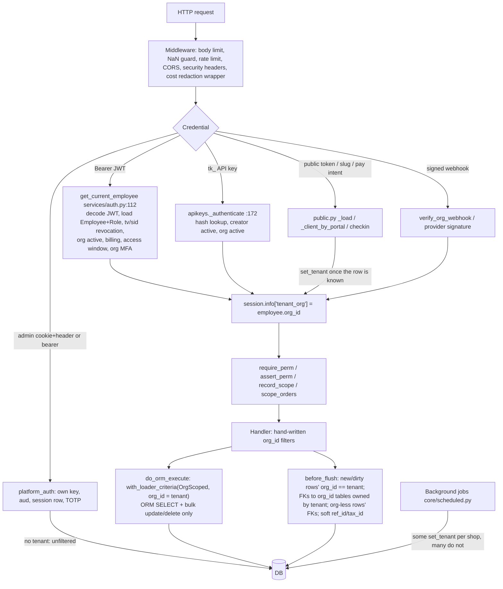

# 01: Tenant isolation, security and authorization (prefix SEC)

Source: `audit-src` snapshot of `roadmap/orderry-parity` @ d353c67b. Read-only. Probes ran on throwaway SQLite from the scratchpad (`scratchpad/sec/probe/test_sec_probe.py`, run with `-p backend.tests.conftest`). Nothing was written to the tree, and `git status` in `audit-src` is clean.

## Summary

| Severity | Count | IDs |
|---|---|---|
| CRITICAL | 0 | none |
| HIGH | 2 | SEC-01, SEC-02 |
| MEDIUM | 6 | SEC-03 to SEC-08 |
| LOW | 5 | SEC-09 to SEC-13 |

I found **no working cross-shop read or write through the HTTP API.** Every candidate IDOR I traced or probed (foreign client, location, employee, part, service, bundle component, supplier, account, shift, order line, asset transfer target) was stopped. Either a hand-written `org_id` filter caught it or the ORM guard did. The prior audit's H1 to H4, M1, M5 to M8, M10 and M11 are fixed, and their regression tests pass (114 tests run).

The real risks are elsewhere:
- **Structural gaps in the guard.** 29 tables have no `org_id`, and `payments`, `cash_shifts` and `order_lines` are among them. Today these are protected only because every caller remembers to scope through the parent row.
- **Role scoping that is weaker than the UI implies.** The account restriction only hides accounts from one list. A role set to "selected locations" with no locations picked sees every location.

## How it works



What the two guards do **not** see. Each item was verified in code, and the marked ones also by probe:
- Reads of the 29 non-org tables. `order_lines`, `payments`, `cash_shifts`, `invoice_lines`, `sale_lines`, `po_lines`, `stock_levels`, `stock_movements`, `chat_messages`, `order_comments`, `wage_records`, `shifts` and others have no `org_id`, so the read guard never filters them. **Probe P1.**
- Deletes of org-less rows. The flush guard only checks `obj.org_id` on deletes. **Probe P2.**
- FKs that point at org-less tables:
  - `refunds.payment_id`, `terminal_charges.payment_id`, `payment_intents.payment_id`
  - `transactions.shift_id`, `payments.shift_id`, `cash_drawer_movements.shift_id`
  - `invoice_lines.order_line_id`, `time_entries.order_line_id`, `stocktake_serials.line_id`

  `_org_fks` requires the target to have `org_id`. **Probes P3 and P4.**
- Sessions with no tenant. On an org-less child row, no foreign key is checked at all. **Probe P5.**
- About 80 soft `*_id` String columns that have no FK. Only `order_lines.ref_id/tax_id`, `sale_lines.ref_id` and `recommendations.ref_id` are checked. **Probe P8.**
- `text()` SQL, `Model.__table__` statements, `from_statement`, and `session.get` hits served from the identity map. These are documented in `tenancy.py:47-58`.

## Prior audit status (items in scope)

| Prior | Status | Evidence |
|---|---|---|
| H1 returns part_id | FIXED | Flush guard checks `client_return_lines.part_id → parts` (org-less row, every FK checked: `tenancy.py:250-253`). Test `test_audit_high_fixes.py::test_return_cannot_restock_another_shops_part` passes (I ran it). |
| H2 job line ref_id → PO → receive | FIXED | `_SOFT_REFS` at `tenancy.py:176`. Tests `test_job_line_cannot_point_at_another_shops_part` and `..._even_with_a_stray_po_line` pass. |
| H3 serial write-off/return | FIXED | `write_off_lines.serialized_item_id` is checked through the org-less FK path. `test_write_off_cannot_touch_another_shops_serial_unit` passes. |
| H4 role "none" escalation | FIXED | `staff.py:181-199` `_assert_can_assign_role`: `if not role_id and not owner` raises 403. `test_scoped_manager_cannot_set_own_role_to_none` passes. |
| M1 feed media XSS | FIXED | `feed.py:28-34` `_MEDIA_RE` only allows base64 `data:` URLs. Tests pass. |
| M2 transfers foreign product | FIXED | `test_transfer_cannot_carry_another_shops_part` passes. |
| M5 ENVIRONMENT default | FIXED | `config.py:52` `ENVIRONMENT: str = "production"`. `:319-321` gives a hard error when it is unset. |
| M6 platform admin 2FA/revocation/timing | FIXED | `platform_auth.py`: TOTP ticket flow, `AdminSession` row with `revoked_at`, `token_version`, and a dummy-hash compare (`admin.py:152-153`). |
| M7 log params | FIXED | `db/database.py:38` sets `hide_parameters=cfg.is_deployed`. |
| M8 TOTP plaintext | FIXED | `mfa.py:38` `crypto.encrypt(secret)`. |
| M9 audit trail | FIXED (sampled) | `sso.py:104` `audit_record(... "sso.create")`. Test file passes. |
| M10 creds decrypt fallback | FIXED | `main.py` `CredentialsUnreadable` handler returns 409. `test_audit_m10_*` passes. |
| M11 SSRF CGNAT / rebinding | FIXED | `core/ssrf.py:44-48` uses `addr.is_global`. Automation webhooks go through the pinned outbox (`automation.py:133-140` → `webhooks.py:617-621` `pinned_target`). |
| R2 sweep rollback per shop | FIXED | `scheduled.py:88-92` and the other sweeps call `db.rollback()` per org. |
| Low: portal links never expire, plaintext | FIXED | `portal_links.py`: SHA-256 hash, 90-day expiry. |
| Low: order track `public_token` | STILL OPEN (by design) | Plaintext, no expiry. Rotate and revoke exist. See SEC-12. |
| Low: API keys outlive creator | FIXED | `apikeys.py:184-190` refuses the key when its creator is inactive. |
| Low: HTML-escape in emails | FIXED | `message_vars.py:71-75`. |
| Low: rate limits per worker without Redis | FIXED | `config.py:426` makes `REDIS_URL` mandatory when `WEB_CONCURRENCY > 1` deployed. `ratelimit.client_ip` trusts only `TRUSTED_PROXY_HOPS`. |
| Low: reset token double redeem | NOT RE-VERIFIED | |

## Findings

### SEC-01 [HIGH] 29 tables, payments among them, sit outside both tenant guards
- **Module:** `backend/db/tenancy.py`; models.
- **Tables/columns:** tables with no `org_id`:
  - `payments`, `cash_shifts`, `order_lines`, `invoice_lines`, `invoice_orders`, `sale_lines`, `po_lines`, `posting_lines`
  - `stock_levels`, `stock_movements`, `stock_transfer_lines`, `write_off_lines`, `stocktake_lines`, `stocktake_serials`
  - `client_return_lines`, `purchase_return_lines`, `credit_note_lines`, `bundle_components`
  - `order_comments`, `order_status_logs`, `chat_messages`, `wage_records`, `shifts`
  - `auth_tokens`, `revoked_sessions`, plus platform tables

  FKs into them that are never ownership-checked:
  - `refunds.payment_id`, `terminal_charges.payment_id`, `payment_intents.payment_id`
  - `transactions.shift_id`, `payments.shift_id`, `cash_drawer_movements.shift_id`
  - `invoice_lines.order_line_id`, `time_entries.order_line_id`, `stocktake_serials.line_id`
- **Functions/APIs:**
  - `_scope_to_tenant` (`tenancy.py:120-136`) only adds criteria for `OrgScoped`.
  - `_org_fks` (`:160-171`) has the condition `"org_id" in target.c`.
  - The delete check (`:238-242`) is `org = getattr(obj, "org_id", None); if org and org != tenant`.
- **Execution flow:** request → tenant set → `select(OrderLine).where(OrderLine.id == x)` returns any shop's row. `session.delete(row)` on that row flushes without a check. `TimeEntry(org_id=A, order_line_id=<B line>)` and `InvoiceLine(invoice_id=<A inv>, order_line_id=<B line>)` both flush.
- **Evidence:** a schema introspection script (`scratchpad/sec/models_out.txt`) lists these tables and FKs. The probe output:
  ```
  P1 B's OrderLine visible under tenant A: True secret line
  P2 delete of B's OrderLine under tenant A flushed OK
  P3 A's TimeEntry -> B's order_line flushed OK
  P4 A's InvoiceLine -> B's order_line flushed OK
  ```
- **Verification level:**
  - The guard gap is **test-verified** (ORM level).
  - Exploitability through the API is **NOT VERIFIED**. I found no current endpoint that loads one of these rows by a bare id. All the call sites I checked pair the child id with a parent id the handler already scoped:
    - `orders.py:4272/5285/5403`
    - `suppliers.py:411/438`
    - `stock_docs.py:520`
    - `sales.py:1351`
    - `transfers.py:612`
    - `timeclock.py:315-320`, which checks `line.order_id != order.id`
    - `finance.py:742-744` `_shift_or_404`
    - `returns.py:352`, which reads `refund.payment_id` from an already-scoped refund
- **Why it's a problem:** `ARCHITECTURE.md` and the `tenancy.py` docstring present the guard as the safety net "under" the hand-written filters. For money tables (payments, cash shifts) and stock tables, there is no net. The next endpoint that does `select(Payment).where(Payment.id == body.payment_id)` or `db.get(OrderLine, line_id)` becomes a cross-shop read, write or delete, and no test will fail. Ids are uuid4, which makes guessing hard but does not stop an attack once an id leaks (webhook payloads, exports, shared links).
- **Real-world failure scenario:** someone adds a future "refund this payment" or "split this line" endpoint that takes `payment_id` or `line_id` in the body and loads it with no parent join. Shop B then refunds or deletes shop A's payment row. The guard stays silent because `payments` has no `org_id`.
- **Recommended fix:**
  - Add `org_id` to at least `payments`, `cash_shifts`, `order_lines`, `invoice_lines`, `sale_lines` and `stock_movements`, backfilled from the parent row, and mark them `OrgScoped`.
  - For the rest, extend the read guard with a parent-join criterion. If that is not done, extend the flush guard so that org-less **deletes** check the parent FK, and so that FKs to org-less targets are resolved through the target's parent.
  - Add a test that fails when a new table has neither `org_id` nor an entry in an allow-list.
- **Fix dependencies/risks:**
  - Migrations on large tables.
  - The flush guard's `_fill_missing_org` pattern can reuse the parent lookup.
  - The `reconcile._stock` and payments queries already join through location or order.

### SEC-02 [HIGH] Account (cash box) restrictions on a role only hide accounts from one list
- **Module:** `services/scoping.py`, `routers/cash.py`, `routers/finance.py`.
- **Tables/columns:** `roles.account_ids`, `transactions.account_id`, `accounts.id`.
- **Functions/APIs:**
  - `scoping.allowed_accounts` / `may_use_account` (`scoping.py:89-101`).
  - Callers: only `cash.py:155` (`GET /api/cash/accounts`) and `payroll.py:1116`. `may_use_account` has **no callers at all**.
- **Execution flow:** a role with `account_ids=["till-1"]` and `can_view_finance` can still call:
  - `GET /api/cash/transactions` (`cash.py:1011-1026`), which filters only `Transaction.org_id`, plus an optional `account_id` the caller chooses;
  - `POST /api/cash/transactions` (`cash.py:281-345`, which checks `can_create_incomes/expenses` but not the account);
  - `/transfer`, `/orders/{id}/pay`, and `/orders/{id}/refund`.

  All of these work on any account in the shop.
- **Evidence:** at `cash.py:155-157`:
  ```python
  allowed = scoping.allowed_accounts(role)
  if allowed is not None:
      rows = [a for a in rows if a.id in allowed]
  ```
  A grep for `may_use_account|allowed_accounts` in the routers returns only `cash.py:155` and `payroll.py:1116`.
- **Verification level:** code-read.
- **Why it's a problem:** the owner configures "this cashier may only use Till 1" and believes it is enforced. It is purely cosmetic.
- **Real-world failure scenario:** a branch cashier opens `/api/cash/transactions?account_id=<HQ bank account>`, sees every HQ movement, and records an expense out of the HQ account.
- **Recommended fix:** call `may_use_account(role, account_id)` in `_create_transaction`, `transfer` (both legs), pay, prepay, refund, the drawer endpoints, `list_transactions` and the summary endpoint. Default the list to the allowed set.
- **Fix dependencies/risks:** the UI must handle the 403s. A shared helper in `scoping` avoids missed call sites.

### SEC-03 [MEDIUM] A role with "selected locations" and none picked sees every location
- **Module:** `services/scoping.py`.
- **Tables/columns:** `roles.location_scope`, `roles.location_ids`.
- **Functions/APIs:** `scope_orders` (`scoping.py:64-67`), `can_view_order` (`:127-130`), `check_location_access` (`services/auth.py:258-276`).
- **Execution flow:** with `location_scope="selected"` and `location_ids="[]"`:
  - `scope_orders` and `can_view_order` skip the filter (`if allowed:`), so every order is visible;
  - `check_location_access` denies every location, because `location_id not in []`.

  The two checks contradict each other.
- **Evidence:** `if allowed and order.location_id not in allowed: return False`.
- **Verification level:** code-read.
- **Why it's a problem:** a mis-saved role fails open on reads. Also, `check_location_access` is applied only at order create (`orders.py:986`), check-ins, `finance.py:1213`, `payroll.py:657` and `reports.py:1337`. Moving an existing order to another location is not location-checked.
- **Real-world failure scenario:** an admin ticks "Selected locations" but saves before picking any. The technician then sees every branch's jobs and clients.
- **Recommended fix:** treat an empty selected list as "none" (deny) everywhere. Add `check_location_access` to every endpoint that changes `orders.location_id`. Reject saving a role with `selected` and an empty list.
- **Fix dependencies/risks:** existing roles in that state would lose visibility, so a migration should report them.

### SEC-04 [MEDIUM] Warehouse scope is enforced on only 6 stock call sites
- **Module:** `services/warehouses.py`.
- **Tables/columns:** `roles.warehouse_scope/warehouse_ids`, `warehouse_access`.
- **Functions/APIs:** `warehouses.guard_action` (`warehouses.py:106-141`). Its callers are `bins.py` (1), `inventory.py` (2), `sales.py` (1) and `stock_docs.py` (2).
- **Execution flow:** order-line stock consumption, PO receive, transfers and stocktakes outside those 6 sites never call `guard_action`. The only other use of `may_use_warehouse` is inside `guard_action` itself.
- **Evidence:** `grep -rn "guard_action(" backend/routers` finds 6 hits.
- **Verification level:** code-read. I did not enumerate every stock-moving endpoint.
- **Why it's a problem:** a role limited to one warehouse can move stock in others through the uncovered paths.
- **Real-world failure scenario:** a branch tech pulls a part from the HQ warehouse onto a job line.
- **Recommended fix:** call `guard_action` inside `stock_posting` / `stock_consume` and the transfer and receive services, rather than per router.
- **Fix dependencies/risks:** service-level enforcement needs the actor passed down.

### SEC-05 [MEDIUM] Background sweeps run with no tenant, and some share one session across shops
- **Module:** `core/scheduled.py`.
- **Tables/columns:** all the tables these sweeps touch.
- **Functions/APIs:**
  - `set_tenant` per shop: only `sweep_notifications` (`:80`), `deliver_notifications` (`:118`) and `sweep_overdue_tasks` (`:400`).
  - No tenant: `sweep_time_automations` (`:154-160`), `sweep_contact_lifecycle` (`:181-188`), `sweep_memberships` (`:201-215`, **one session for every shop**), `sweep_morning_briefs` (`:326-341`, one session), `sweep_sense_agents` (`:355-368`, one session), `sweep_status_sla` and `autocomplete_replied_chats` (all shops in one session).
- **Execution flow:** in a no-tenant session, the read guard is off, and the flush guard only compares an org row's FKs with that row's own `org_id`. Org-less child rows (payments, order_lines, stock_movements) get **no FK check at all**. In a shared session, rows loaded for shop 1 stay in the identity map while shop 2 is processed.
- **Evidence:** `tenancy.py:250-252`:
  ```python
  if not org:
      if has_org or not tenant:
          continue
  ```
  **Probe P5:** `Payment(order_id=<A order>, client_id=<B client>)` flushes OK in a no-tenant session, and is refused once a tenant is set (P5b).
- **Verification level:** the guard behaviour is test-verified. An actual cross-shop write by a sweep is NOT VERIFIED; the memberships and sense code I sampled scopes by `org_id`.
- **Why it's a problem:** the "safety net" is off in exactly the code that runs unattended across every shop. A bug that mixes up ids writes silently.
- **Real-world failure scenario:** a membership sweep for shop 2 reuses a `client` object or id cached from shop 1 and bills or messages the wrong shop's customer. Nothing refuses the write.
- **Recommended fix:** open one session per shop and call `set_tenant(db, oid)` in every per-shop sweep. That means memberships, time automations, contact lifecycle, sense briefs and sense agents.
- **Fix dependencies/risks:** platform-wide sweeps (reconcile, retention, the SLA sweep) should stay explicit opt-outs.

### SEC-06 [MEDIUM] About 130 authenticated write routes have no route-level permission. Several have none inline either.
- **Module:** routers.
- **Tables/columns:** `devices.client_id/location_id/owner_type`, `chat_messages`, `leads`.
- **Functions/APIs:** a route introspection script lists 1,119 routes. 134 non-GET staff routes have no `require_perm` (list in `scratchpad/sec/noperm_writes.txt`). Many check inline (`assert_perm`, `_assert_line_rights`, `importer.assert_access`). Confirmed ungated examples:
  - `assets.transfer_asset` (`assets.py:621-643`) changes an asset's owner and location with only `get_current_employee`. There is no inventory permission check and no location-scope check. `write_off_asset`, right below it, requires `can_manage_inventory`.
  - `chats.receive_inbound` (`chats.py:208-221`) lets any staff member record a fake "customer" inbound message, which triggers notifications.
  - `leads.create_lead` and `leads.update_lead` (`leads.py:183,223`).
- **Execution flow:** a roleless invitee or a restricted technician calls `POST /api/assets/{id}/transfer {"to_client_id": X}`, and the asset is reassigned.
- **Evidence:** `async def transfer_asset(... current: Employee = Depends(get_current_employee))`, with no perm call in the body. Probe P7 confirms that a **foreign** client is refused (404). The same-shop authorization gap remains.
- **Verification level:** the route list is test-verified (introspection). The ungated examples are code-read.
- **Why it's a problem:** the permission model looks default-deny, but these routes are default-allow for any active employee, roleless invitees included.
- **Real-world failure scenario:** a technician hands a company loaner tablet to their own client record.
- **Recommended fix:** add route-level `require_perm` to the confirmed ones. Add a CI test that fails when a staff write route has neither `require_perm` nor an allow-listed inline check.
- **Fix dependencies/risks:** the allow-list needs upkeep.

### SEC-07 [MEDIUM] SSO email-domain claim has no proof of ownership
- **Module:** `routers/sso.py`.
- **Tables/columns:** `sso_connections.email_domain`, `issuer`.
- **Functions/APIs:** `create_config` (`sso.py:85-110`), `discover` (unauthenticated, `:130-146`), `authorize` (unauthenticated, `:149-170`).
- **Execution flow:** shop A registers `email_domain="victimcorp.com"` with an attacker-controlled `issuer`. "First come" wins (`:93-98`). `GET /api/sso/discover?email=x@victimcorp.com` then returns A's connection. `authorize` returns the authorization URL `{issuer}/authorize?...` on the attacker's host.
- **Evidence:** the only check is the comment "One shop per domain: otherwise a second shop could claim yours". There is no DNS or email verification.
- **Verification level:** code-read. There is no callback yet (`authorize` is a "gated seam"), so this is phishing-grade today, not account takeover.
- **Why it's a problem:** the sign-in page sends the victim company's staff to an attacker's IdP. It also blocks the real owner from claiming its own domain.
- **Real-world failure scenario:** a competitor squats the domain of a large repair chain before that chain onboards.
- **Recommended fix:** require domain verification (a DNS TXT record) before `enabled`/routing, and an admin path to release a domain. Before building the callback, require that the verified domain match the asserted email.
- **Fix dependencies/risks:** this must land before the OIDC callback ships.

### SEC-08 [MEDIUM] Soft id columns are written unvalidated (about 80 String `*_id` columns with no FK)
- **Module:** many routers.
- **Tables/columns:**
  - Probed or read: `locations.price_type_id`, `organisations.cash_category_tickets_id`, `organisations.cash_category_sales_id`, `custom_fields.upsell_ref_id`, `taggables.entity_id`, `tax_exceptions.target_id`.
  - Not traced: `transactions.reverses_txn_id`, `sales.coupon_id`, `membership_usage.order_line_id`, `recommendations.order_line_id/source_ref_id`.
- **Functions/APIs:** `staff.create_location` (`staff.py:712-729`), `staff.set_cash_defaults` (`:1231-1242`), `forms._apply_upsell_cfg` (`forms.py:211-218`), `settings_finance.create_tax_exception` (`:327-337`, which checks `tax_id` only).
- **Execution flow:** **Probe P8:** shop A creates a location with `price_type_id=<shop B's price type>` and gets 201.
- **Evidence:** `ln = Location(... price_type_id=data.price_type_id)`, with no ownership check.
- **Verification level:**
  - P8 is test-verified.
  - The impact is code-read. In request context the read guard filters `PriceTypeItem`/`PriceType` to the tenant, so the foreign id resolves to nothing.
  - No-tenant consumers of these ids are NOT VERIFIED.
- **Why it's a problem:** the flush guard is blind to these columns, so safety depends on every reader being in a tenant session. Background jobs are not (see SEC-05).
- **Real-world failure scenario:** today, mostly broken data: a price level that silently does nothing.
- **Recommended fix:** use `require_owned_ids` on every soft id that is written, or add them to `_SOFT_REFS`. Long term, convert them to real FKs.
- **Fix dependencies/risks:** low.

### SEC-09 [LOW] Push subscription takeover by endpoint URL
- `push.py:41-53`: any signed-in employee of any shop who knows a browser's push endpoint URL re-assigns that subscription to themselves, using an explicit `skip_tenant_filter` bulk update. This is by design ("whoever subscribes it last owns it"). Push endpoint URLs are capability-like secrets, so the risk is low.
- Code-read. **Fix:** require that the existing row belongs to the same employee, or rotate on conflict.

### SEC-10 [LOW] `/api/public/lookup` order-number enumeration when the phone is known
- `public.py:1707-1768`. With no `shop`, an attacker who knows a victim's phone tries sequential order numbers across every shop. The limits are 20 per minute per IP and 5 per hour per (IP, number). Each hit returns the order's `public_token`.
- Code-read. **Fix:** require `shop`, and add a global per-phone bucket.

### SEC-11 [LOW] `role_allows(None, …)` is True
- `permissions.py:237-238`: `if not role: return True`. Callers that load a role by id and get `None` treat it as owner, for example `finance.py close_shift` `show_expected`. In practice this is unreachable: deleting a role in use is refused (`rbac.py:259-262`), and `has_perm` handles `None` safely (`auth.py:233-235`).
- Code-read. **Fix:** make it fail closed. The owner check belongs in `has_perm`.

### SEC-12 [LOW] Order track tokens never expire and are stored in plaintext
- `orders.py:57-70` (`token_urlsafe(16)`) and `public.py:54-62`. Rotate and revoke exist (`/public-link/rotate|revoke`), but a forwarded SMS works forever. This item is carried over from the prior audit.
- **Fix:** hash at rest plus an optional expiry, as `portal_links` already does.

### SEC-13 [LOW] `order_statuses` reads are not tenant-filtered
- `UNSCOPED_ORG_TABLES` (`tenancy.py:90-95`). Shop B can read shop A's custom status rows (names) by id if an endpoint loads by bare id. Writes referencing them are refused by the flush guard, because the table has `org_id`.
- NOT VERIFIED: I did not trace the status endpoints.
- **Fix:** filter with `org_id IN (tenant, NULL)`.

## Orderry rule checks (coordinator questions 28, 29, 31)

- **28. Is `require_perm` default-allow for unknown or missing codes?** **No**, for any role in use today.
  - `role_allows` (`permissions.py:231-244`) is default-deny for `perms_explicit` roles.
  - Every role the code creates is explicit: `auth.py:319` (signup admin) and `rbac.py:201` (new roles). Migration `rp144p8` snapshotted all legacy roles.
  - A roleless non-owner is denied (`auth.py:229-230`). The owner gets everything (`auth.py:227`), unknown codes included.
  - All 108 codes used in `require_perm/assert_perm/has_perm/role_allows` exist in `ALL_CODES` (script check: "unknown: []").
  - Money codes are gated:
    - refund: `can_view_finance` on `DELETE /refunds/{id}` (`returns.py:362-367`) and the order refund routes;
    - retro entries: `assert_perm(... "can_retroactive_cash")` (`finance.py:731-732`);
    - create income/expense: `cash.py:298`;
    - cost view: `can_view_purchase_price`.
  - Residual: legacy non-explicit roles would still be deny-wins (`:244`), and API keys bypass every perm (`auth.py:225-226`, by design, scoped by key scope). I did not individually check the delete- and restore-transaction gates beyond `require_perm("can_view_finance")` on the router.
- **29. Are location-scoped roles enforced on orders, accounts and warehouses?** **Partly.** There is no `in_location_scope` function. The helpers are `scope_orders`, `can_view_order`, `check_location_access`, `allowed_accounts` and `allowed_warehouses`.
  - Orders: yes for lists, and for `{order_id}` routes through `record_scope` (279 routes). An empty selection fails open (SEC-03), and changing an order's location is not checked.
  - Accounts: **no**, the list only (SEC-02).
  - Warehouses: only 6 call sites (SEC-04).
- **31. Are purchase price, avg_cost and profit stripped server-side for roles without view-cost?** **Yes, for JSON.**
  - `CostRedactionMiddleware` (`core/cost_redaction.py`) buffers every `/api/` JSON response for a viewer without `can_view_purchase_price` and removes `COST_KEYS` recursively. Those keys include `cost_price`, `avg_cost`, `unit_cost`, `margin`, `profit`, `cogs` and `stock_value`, plus PO totals (`redact.py:12-31`).
  - Writes drop cost fields (`drop_cost_fields`; `orders.py` `_add_line` resets `cost_price` to the catalog value).
  - Non-JSON outputs are handled per endpoint: the products XLSX (`catalog_products.py:579-582` `show_cost`) and report exports (`_assert_report_access(... export=True)`).
  - Caveat: the redaction is key-name based. A new cost field under another name, or a PDF or HTML document, is not covered automatically. I did not test this with a probe.

## 1. Inspected
- `backend/db/tenancy.py` (all of it)
- `services/auth.py` (all of it)
- `services/permissions.py` (`role_allows`)
- `services/scoping.py` (all of it)
- `services/apikeys.py` (auth)
- `services/platform_auth.py`, `services/admin_access.py` (outline), `routers/admin.py` (login, plan, approvals)
- `services/sessions.py` (issue)
- `routers/devices.py`, `routers/mfa.py`, `routers/auth.py` (login, refresh)
- `core/jobs.py`, `core/scheduled.py`
- `services/webhooks.py` (delivery)
- `core/webhook_security.py`
- `routers/public.py` (track, portal, pay, lookup, E5 line drop)
- `routers/payments.py` (public intents)
- `routers/sso.py`, `push.py`, `tags.py`, `imports.py`, `bundles.py`
- `routers/assets.py` (transfer), `chats.py` (inbound, meta)
- `routers/cash.py` (accounts, transactions, sub-invoice), `finance.py` (invoice pay, shifts), `timeclock.py` (start)
- `routers/staff.py` (role assign, location, cash defaults)
- `routers/returns.py` (refund payment), `transfers.py` (receive line)
- `services/reconcile.py`, `services/terminal.py` (opt-outs)
- `routers/industry.py` and `inventory.py` (Device opt-outs)
- `services/portal_links.py`, `services/redact.py`, `core/cost_redaction.py`, `core/ssrf.py` (allow-list)
- `services/message_vars.py` (escaping)
- `services/ratelimit.py` (`client_ip`)
- `config.py` (validators)
- `routers/platform.py` (metrics)
- Every `skip_tenant_filter` site (15). All are safe: they are column-only reads, or entity reads with an ownership `WHERE`, or the push re-assignment (SEC-09).
- Every `__table__` and `text()` call outside migrations. `public.py:584-588` scopes by `order.id`. `directories.py:179` scopes by directory id. The rest are metadata or advisory locks.

## 2. Not inspected
- Every handler of the 134 ungated routes individually (I sampled about 25).
- Large routers in depth: `orders.py` (5.7k lines), `inventory.py`, `documents.py`, `sales.py`, `reports.py`, `payroll.py` beyond the cited spots.
- `services/memberships.py`, `sense*.py` and `automation.py` bodies for unscoped queries.
- `services/crypto.py`, `org_creds.py` and `db/secret_json.py` internals (M10 only through its test).
- Uploads and `media.py` storage paths.
- The Stripe, Square and Twilio signature code (beyond the prior audit and the M-tests).
- The email OAuth and QBO/Xero callbacks.
- The v1 and v2 API handlers beyond auth.
- The frontend.

## 3. Verified (by test or probe)
- Probe file `scratchpad/sec/probe/test_sec_probe.py`, 9 passed:
  - P1 to P4: guard gaps on org-less tables.
  - P5 and P5b: org-less child FKs are unchecked without a tenant and refused with one.
  - P7: asset transfer to a foreign client returns 404.
  - P8: a foreign `price_type_id` is accepted.
  - P6 returned 422 from bad probe input, so it is inconclusive.
- Existing suites passed:
  - tenancy: 34 tests (`test_cross_tenant_references`, `test_idor_tenant_isolation`, `test_tenant_isolation`, `test_tenant_read_guard`, `test_scan_resolve_tenancy`);
  - prior-audit fixes: 80 tests (`test_audit_high_fixes`, `m5`, `m7`, `m8`, `m9`, `m10`, `m11`, `test_staff_privilege_escalation`).
- Route introspection: 1,119 routes. 108 have no auth dependency; all are public by design (track, portal, booking, check-in, signed webhooks, auth, SPA). 134 staff write routes have no route-level permission.
- Permission codes: 108 used, 0 unknown.

## 4. Uncertain
- Whether any endpoint I did not read loads an org-less child row (payment, order line, shift) by a bare request id. If one exists, SEC-01 is CRITICAL.
- Whether membership or sense sweeps mix shops in their shared session (SEC-05).
- Whether soft ids are consumed in no-tenant contexts (SEC-08).
- Gates on delete and restore transaction beyond `can_view_finance`.

## 5. Needs staging to test properly
- The Postgres advisory-lock job election and per-shop sweeps under multiple workers.
- Redis-backed rate limits behind the real proxy (`TRUSTED_PROXY_HOPS`).
- Live Stripe, Square, Twilio and Meta webhook signatures with real per-shop secrets.
- The SSO flow once a callback exists.
- Cost redaction on PDF and HTML documents with a restricted role in a real browser.
