# 02 — ER diagrams (Tekly schema, `roadmap/orderry-parity` @ d353c67b)

These diagrams were generated from `Base.metadata` (`scratchpad/dbprobe/gen_er.py`), so every relationship line is a real declared FK. The schema has 193 tables, so the diagrams are split into 6 domains.

**Conventions:**
- **Attributes.** Each entity shows:
  - its PK;
  - `org_id`, annotated NOT NULL / NULLABLE, plus "not scoped" when the read guard skips the table;
  - `NO_org_id "tenant via parent"` on tenant tables that have no org_id (DB-01/DB-02);
  - the FK columns that point inside the same diagram;
  - up to 5 money, quantity or status columns. `FLOAT` marks a binary float column (DB-08).
- **Relationship lines.**
  - `||--o{` is a NOT NULL FK; `|o--o{` is a nullable FK.
  - The label is the FK column, and a CASCADE or SET NULL rule is shown in quotes on the attribute.
  - `organisations →` edges are drawn only in diagram 1. Every OrgScoped table also has `org_id → organisations` (NO ACTION).
- **Missing links.** FKs pointing to a table in another domain are omitted, and that table is listed in the relationship map at the end. Soft references (string ids with no FK, DB-13) are **not** drawn, because the database does not know about them.

## 1. Tenancy & people

```mermaid
erDiagram
  ORGANISATIONS {
    string id PK
  }
  LOCATIONS {
    string id PK
    string org_id FK "NOT NULL"
    string legal_entity_id FK
  }
  LEGAL_ENTITIES {
    string id PK
    string org_id FK "NOT NULL"
  }
  ROLES {
    string id PK
    string org_id FK "NOT NULL"
  }
  EMPLOYEES {
    string id PK
    string org_id FK "NOT NULL"
    string location_id FK
    string role_id FK
  }
  EMPLOYEE_GROUPS {
    string id PK
    string org_id FK "NOT NULL"
  }
  AUTH_SESSIONS {
    string id PK
    string org_id FK "NOT NULL"
    string employee_id FK "CASCADE"
  }
  REVOKED_SESSIONS {
    string sid PK
    string NO_org_id "tenant via parent"
    string employee_id FK "CASCADE"
  }
  AUTH_TOKENS {
    string id PK
    string NO_org_id "tenant via parent"
    string employee_id FK
    string kind
  }
  INVITES {
    string id PK
    string org_id FK "NOT NULL"
    string role_id FK
    string location_id FK
    string invited_by FK
  }
  API_KEYS {
    string id PK
    string org_id FK "NOT NULL"
    string created_by_id FK
  }
  SSO_CONNECTIONS {
    string id PK
    string org_id FK "NOT NULL"
  }
  USER_PREFS {
    string id PK
    string org_id FK "NOT NULL"
    string employee_id FK
    json value
  }
  SHIFTS {
    string id PK
    string NO_org_id "tenant via parent"
    string employee_id FK
    string location_id FK
  }
  TIME_ENTRIES {
    string id PK
    string org_id FK "NOT NULL"
    string employee_id FK
    string location_id FK
    string approved_by_id FK
    string state
  }
  TIME_ENTRY_AUDITS {
    string id PK
    string org_id FK "NOT NULL"
    string time_entry_id FK
    string actor_id FK
  }
  WORK_SCHEDULES {
    string id PK
    string org_id FK "NOT NULL"
    string employee_id FK
    string location_id FK
    string kind
  }
  PAYROLL_RUNS {
    string id PK
    string org_id FK "NOT NULL"
    string employee_id FK
    string voided_by_id FK
    numeric gross_total
    string status
  }
  EMPLOYEE_BALANCE_LEDGER {
    string id PK
    string org_id FK "NOT NULL"
    string employee_id FK
    string rule_id FK
    numeric amount
  }
  COMMISSION_RULES {
    string id PK
    string org_id FK "NOT NULL"
    string employee_id FK
    numeric amount
  }
  EMPLOYEE_COEFFICIENTS {
    string id PK
    string org_id FK "NOT NULL"
    string employee_id FK
  }
  WAGE_RECORDS {
    string id PK
    string NO_org_id "tenant via parent"
    string employee_id FK
  }
  WAREHOUSE_ACCESS {
    string id PK
    string org_id FK "NOT NULL"
    string employee_id FK
  }
  PLATFORM_ADMINS {
    string id PK
  }
  ADMIN_ROLES {
    string id PK
  }
  ADMIN_SESSIONS {
    string id PK
    string admin_id FK
  }
  ADMIN_SHOP_NOTES {
    string id PK
    string org_id FK "NOT NULL"
    string kind
  }
  ADMIN_ASSIGNMENT_LOG {
    string id PK
    string org_id FK "NOT NULL"
  }
  ADMIN_APPROVAL_REQUESTS {
    string id PK
    string org_id FK "NOT NULL"
    string status
  }
  ORGANISATIONS ||--o{ LOCATIONS : "org_id"
  LEGAL_ENTITIES |o--o{ LOCATIONS : "legal_entity_id"
  ORGANISATIONS ||--o{ LEGAL_ENTITIES : "org_id"
  ORGANISATIONS ||--o{ ROLES : "org_id"
  ORGANISATIONS ||--o{ EMPLOYEES : "org_id"
  LOCATIONS |o--o{ EMPLOYEES : "location_id"
  ROLES |o--o{ EMPLOYEES : "role_id"
  ORGANISATIONS ||--o{ EMPLOYEE_GROUPS : "org_id"
  EMPLOYEES ||--o{ AUTH_SESSIONS : "employee_id"
  ORGANISATIONS ||--o{ AUTH_SESSIONS : "org_id"
  EMPLOYEES |o--o{ REVOKED_SESSIONS : "employee_id"
  EMPLOYEES ||--o{ AUTH_TOKENS : "employee_id"
  ORGANISATIONS ||--o{ INVITES : "org_id"
  ROLES |o--o{ INVITES : "role_id"
  LOCATIONS |o--o{ INVITES : "location_id"
  EMPLOYEES |o--o{ INVITES : "invited_by"
  ORGANISATIONS ||--o{ API_KEYS : "org_id"
  EMPLOYEES |o--o{ API_KEYS : "created_by_id"
  ORGANISATIONS ||--o{ SSO_CONNECTIONS : "org_id"
  ORGANISATIONS ||--o{ USER_PREFS : "org_id"
  EMPLOYEES ||--o{ USER_PREFS : "employee_id"
  EMPLOYEES ||--o{ SHIFTS : "employee_id"
  LOCATIONS ||--o{ SHIFTS : "location_id"
  ORGANISATIONS ||--o{ TIME_ENTRIES : "org_id"
  EMPLOYEES ||--o{ TIME_ENTRIES : "employee_id"
  LOCATIONS |o--o{ TIME_ENTRIES : "location_id"
  EMPLOYEES |o--o{ TIME_ENTRIES : "approved_by_id"
  ORGANISATIONS ||--o{ TIME_ENTRY_AUDITS : "org_id"
  TIME_ENTRIES ||--o{ TIME_ENTRY_AUDITS : "time_entry_id"
  EMPLOYEES |o--o{ TIME_ENTRY_AUDITS : "actor_id"
  ORGANISATIONS ||--o{ WORK_SCHEDULES : "org_id"
  EMPLOYEES ||--o{ WORK_SCHEDULES : "employee_id"
  LOCATIONS |o--o{ WORK_SCHEDULES : "location_id"
  ORGANISATIONS ||--o{ PAYROLL_RUNS : "org_id"
  EMPLOYEES ||--o{ PAYROLL_RUNS : "employee_id"
  EMPLOYEES |o--o{ PAYROLL_RUNS : "voided_by_id"
  ORGANISATIONS ||--o{ EMPLOYEE_BALANCE_LEDGER : "org_id"
  EMPLOYEES ||--o{ EMPLOYEE_BALANCE_LEDGER : "employee_id"
  COMMISSION_RULES |o--o{ EMPLOYEE_BALANCE_LEDGER : "rule_id"
  ORGANISATIONS ||--o{ COMMISSION_RULES : "org_id"
  EMPLOYEES |o--o{ COMMISSION_RULES : "employee_id"
  ORGANISATIONS ||--o{ EMPLOYEE_COEFFICIENTS : "org_id"
  EMPLOYEES ||--o{ EMPLOYEE_COEFFICIENTS : "employee_id"
  EMPLOYEES ||--o{ WAGE_RECORDS : "employee_id"
  ORGANISATIONS ||--o{ WAREHOUSE_ACCESS : "org_id"
  EMPLOYEES ||--o{ WAREHOUSE_ACCESS : "employee_id"
  PLATFORM_ADMINS ||--o{ ADMIN_SESSIONS : "admin_id"
```



## 2. Clients & CRM

```mermaid
erDiagram
  CLIENTS {
    string id PK
    string org_id FK "NOT NULL"
    string payer_id FK
    numeric balance
  }
  DEVICES {
    string id PK
    string org_id FK "NULLABLE"
    string client_id FK
  }
  CLIENT_PORTAL_LINKS {
    string id PK
    string org_id FK "NOT NULL"
    string client_id FK "CASCADE"
  }
  CONSENT_LOG {
    string id PK
    string org_id FK "NOT NULL"
    string client_id FK
  }
  LEADS {
    string id PK
    string org_id FK "NOT NULL"
    string client_id FK
    string lead_type_id FK
    string status
  }
  LEAD_TYPES {
    string id PK
    string org_id FK "NOT NULL"
  }
  CHECKINS {
    string id PK
    string org_id FK "NOT NULL"
    string point_id FK
    string lead_id FK
    string kind
    string state
  }
  CHECKIN_POINTS {
    string id PK
    string org_id FK "NOT NULL"
  }
  APPOINTMENTS {
    string id PK
    string org_id FK "NOT NULL"
    string client_id FK
    string status
  }
  CHAT_THREADS {
    string id PK
    string org_id FK "NOT NULL"
    string client_id FK
    string lead_id FK
    string status
  }
  CHAT_MESSAGES {
    string id PK
    string NO_org_id "tenant via parent"
    string thread_id FK
    string status
  }
  INBOX_THREADS {
    string id PK
    string org_id FK "NOT NULL"
    string client_id FK
    string status
  }
  INBOX_MESSAGES {
    string id PK
    string org_id FK "NOT NULL"
    string thread_id FK
  }
  CALLS {
    string id PK
    string org_id FK "NOT NULL"
    string client_id FK
    string status
  }
  CAMPAIGNS {
    string id PK
    string org_id FK "NOT NULL"
    string status
  }
  FEEDBACK {
    string id PK
    string org_id FK "NOT NULL"
    string client_id FK
  }
  TAGS {
    string id PK
    string org_id FK "NOT NULL"
  }
  TAGGABLES {
    string id PK
    string org_id FK "NOT NULL"
    string tag_id FK
  }
  MERGE_LOGS {
    string id PK
    string org_id FK "NOT NULL"
  }
  MEMBERSHIPS {
    string id PK
    string org_id FK "NOT NULL"
    string plan_id FK
    string client_id FK
    string device_id FK
    numeric price
    string status
  }
  MEMBERSHIP_PLANS {
    string id PK
    string org_id FK "NOT NULL"
  }
  MEMBERSHIP_PLAN_ITEMS {
    string id PK
    string org_id FK "NOT NULL"
    string plan_id FK
    string kind
    int qty
  }
  MEMBERSHIP_ASSETS {
    string id PK
    string org_id FK "NOT NULL"
    string membership_id FK
    string device_id FK
  }
  MEMBERSHIP_PERIODS {
    string id PK
    string org_id FK "NOT NULL"
    string membership_id FK
    numeric amount
  }
  MEMBERSHIP_USAGE {
    string id PK
    string org_id FK "NOT NULL"
    string membership_id FK
    string plan_item_id FK
    string device_id FK
    FLOAT qty
    numeric value
  }
  CLIENT_LEDGER_ENTRIES {
    string id PK
    string org_id FK "NOT NULL"
    string client_id FK
    numeric amount
  }
  LOYALTY_LEDGER {
    string id PK
    string org_id FK "NOT NULL"
    string client_id FK
    FLOAT points
  }
  COUPONS {
    string id PK
    string org_id FK "NOT NULL"
    string client_id FK
    string kind
    numeric value
  }
  GIFT_CARDS {
    string id PK
    string org_id FK "NOT NULL"
    string client_id FK
    numeric initial_value
    numeric balance
  }
  GIFT_CARD_LEDGER {
    string id PK
    string org_id FK "NOT NULL"
    string gift_card_id FK
    numeric amount
  }
  CLIENTS |o--o{ CLIENTS : "payer_id"
  CLIENTS |o--o{ DEVICES : "client_id"
  CLIENTS ||--o{ CLIENT_PORTAL_LINKS : "client_id"
  CLIENTS ||--o{ CONSENT_LOG : "client_id"
  CLIENTS |o--o{ LEADS : "client_id"
  LEAD_TYPES |o--o{ LEADS : "lead_type_id"
  CHECKIN_POINTS ||--o{ CHECKINS : "point_id"
  LEADS ||--o{ CHECKINS : "lead_id"
  CLIENTS |o--o{ APPOINTMENTS : "client_id"
  CLIENTS |o--o{ CHAT_THREADS : "client_id"
  LEADS |o--o{ CHAT_THREADS : "lead_id"
  CHAT_THREADS ||--o{ CHAT_MESSAGES : "thread_id"
  CLIENTS |o--o{ INBOX_THREADS : "client_id"
  INBOX_THREADS ||--o{ INBOX_MESSAGES : "thread_id"
  CLIENTS |o--o{ CALLS : "client_id"
  CLIENTS |o--o{ FEEDBACK : "client_id"
  TAGS ||--o{ TAGGABLES : "tag_id"
  MEMBERSHIP_PLANS ||--o{ MEMBERSHIPS : "plan_id"
  CLIENTS ||--o{ MEMBERSHIPS : "client_id"
  DEVICES |o--o{ MEMBERSHIPS : "device_id"
  MEMBERSHIP_PLANS ||--o{ MEMBERSHIP_PLAN_ITEMS : "plan_id"
  MEMBERSHIPS ||--o{ MEMBERSHIP_ASSETS : "membership_id"
  DEVICES ||--o{ MEMBERSHIP_ASSETS : "device_id"
  MEMBERSHIPS ||--o{ MEMBERSHIP_PERIODS : "membership_id"
  MEMBERSHIPS ||--o{ MEMBERSHIP_USAGE : "membership_id"
  MEMBERSHIP_PLAN_ITEMS |o--o{ MEMBERSHIP_USAGE : "plan_item_id"
  DEVICES |o--o{ MEMBERSHIP_USAGE : "device_id"
  CLIENTS ||--o{ CLIENT_LEDGER_ENTRIES : "client_id"
  CLIENTS ||--o{ LOYALTY_LEDGER : "client_id"
  CLIENTS |o--o{ COUPONS : "client_id"
  CLIENTS |o--o{ GIFT_CARDS : "client_id"
  GIFT_CARDS ||--o{ GIFT_CARD_LEDGER : "gift_card_id"
```



## 3. Work orders & assets

```mermaid
erDiagram
  ORDERS {
    string id PK
    string org_id FK "NOT NULL"
    string device_id FK
    string signature_blob_id FK
    string resource_id FK
    string type_id FK
    string split_from_order_id FK
    string continued_from_order_id FK "SET NULL"
    string status
    numeric written_off
    numeric discount
    numeric tax
    numeric total
  }
  ORDER_ITEMS {
    string id PK
    string org_id FK "NOT NULL"
    string order_id FK
    string asset_id FK
  }
  ORDER_LINES {
    string id PK
    string NO_org_id "tenant via parent"
    string order_id FK
    string order_item_id FK
    string line_type
    FLOAT qty
    numeric unit_price
    numeric cost_price
    string kind
  }
  ORDER_STATUSES {
    string id PK
    string org_id FK "NULLABLE, not scoped"
  }
  ORDER_STATUS_LOGS {
    string id PK
    string NO_org_id "tenant via parent"
    string order_id FK
  }
  ORDER_COMMENTS {
    string id PK
    string NO_org_id "tenant via parent"
    string order_id FK
  }
  STATUS_TRANSITIONS {
    string id PK
    string org_id FK "NOT NULL"
    string from_status_id FK
    string to_status_id FK
  }
  WORK_ORDER_TYPES {
    string id PK
    string org_id FK "NOT NULL"
  }
  ORDER_CHECKLISTS {
    string id PK
    string org_id FK "NOT NULL"
    string order_id FK "CASCADE"
    string template_id FK
    string status
  }
  ORDER_CHECKLIST_ITEMS {
    string id PK
    string org_id FK "NOT NULL"
    string order_id FK "CASCADE"
    string checklist_id FK "CASCADE"
    text value
  }
  CHECKLIST_TEMPLATES {
    string id PK
    string org_id FK "NOT NULL"
    string type_id FK
  }
  CHECKLIST_STEPS {
    string id PK
    string org_id FK "NOT NULL"
    string template_id FK "CASCADE"
  }
  CHECKLIST_SECTIONS {
    string id PK
    string org_id FK "NOT NULL"
    string step_id FK "CASCADE"
  }
  CHECKLIST_TEMPLATE_ITEMS {
    string id PK
    string org_id FK "NOT NULL"
    string template_id FK "CASCADE"
    string section_id FK "CASCADE"
  }
  RECOMMENDATIONS {
    string id PK
    string org_id FK "NOT NULL"
    string order_id FK
    string order_item_id FK
    string kind
    FLOAT qty
    numeric unit_price
    string status
  }
  DOCUMENT_SIGNATURES {
    string id PK
    string org_id FK "NOT NULL"
    string order_id FK
  }
  ESTIMATE_REVISIONS {
    string id PK
    string org_id FK "NOT NULL"
    string order_id FK
    numeric total
  }
  EVENT_FEED_ITEMS {
    string id PK
    string org_id FK "NOT NULL"
    string media_blob_id FK
  }
  TASKS {
    string id PK
    string org_id FK "NOT NULL"
    string order_id FK
    string parent_task_id FK
    string status
  }
  RESOURCES {
    string id PK
    string org_id FK "NOT NULL"
    string kind
  }
  ASSET_MOVEMENTS {
    string id PK
    string org_id FK "NOT NULL"
    string asset_id FK
    string order_id FK
  }
  ASSET_GROUPS {
    string id PK
    string org_id FK "NOT NULL"
  }
  ASSET_BRANDS {
    string id PK
    string org_id FK "NOT NULL"
    string asset_group_id FK
  }
  ASSET_MODELS {
    string id PK
    string org_id FK "NOT NULL"
    string brand_id FK
    string asset_group_id FK
  }
  ASSET_PRODUCT_CONVERSIONS {
    string id PK
    string org_id FK "NOT NULL"
    string device_id FK
    string asset_group_id FK
    string status
  }
  DEVICES {
    string id PK
    string org_id FK "NULLABLE"
    string asset_group_id FK
  }
  MEDIA_BLOBS {
    string id PK
    string org_id FK "NOT NULL"
  }
  DEVICES |o--o{ ORDERS : "device_id"
  MEDIA_BLOBS |o--o{ ORDERS : "signature_blob_id"
  RESOURCES |o--o{ ORDERS : "resource_id"
  WORK_ORDER_TYPES |o--o{ ORDERS : "type_id"
  ORDERS |o--o{ ORDERS : "split_from_order_id"
  ORDERS |o--o{ ORDERS : "continued_from_order_id"
  ORDERS ||--o{ ORDER_ITEMS : "order_id"
  DEVICES |o--o{ ORDER_ITEMS : "asset_id"
  ORDERS ||--o{ ORDER_LINES : "order_id"
  ORDER_ITEMS |o--o{ ORDER_LINES : "order_item_id"
  ORDERS ||--o{ ORDER_STATUS_LOGS : "order_id"
  ORDERS ||--o{ ORDER_COMMENTS : "order_id"
  ORDER_STATUSES ||--o{ STATUS_TRANSITIONS : "from_status_id"
  ORDER_STATUSES ||--o{ STATUS_TRANSITIONS : "to_status_id"
  ORDERS ||--o{ ORDER_CHECKLISTS : "order_id"
  CHECKLIST_TEMPLATES |o--o{ ORDER_CHECKLISTS : "template_id"
  ORDERS ||--o{ ORDER_CHECKLIST_ITEMS : "order_id"
  ORDER_CHECKLISTS |o--o{ ORDER_CHECKLIST_ITEMS : "checklist_id"
  WORK_ORDER_TYPES |o--o{ CHECKLIST_TEMPLATES : "type_id"
  CHECKLIST_TEMPLATES ||--o{ CHECKLIST_STEPS : "template_id"
  CHECKLIST_STEPS ||--o{ CHECKLIST_SECTIONS : "step_id"
  CHECKLIST_TEMPLATES ||--o{ CHECKLIST_TEMPLATE_ITEMS : "template_id"
  CHECKLIST_SECTIONS |o--o{ CHECKLIST_TEMPLATE_ITEMS : "section_id"
  ORDERS ||--o{ RECOMMENDATIONS : "order_id"
  ORDER_ITEMS |o--o{ RECOMMENDATIONS : "order_item_id"
  ORDERS ||--o{ DOCUMENT_SIGNATURES : "order_id"
  ORDERS ||--o{ ESTIMATE_REVISIONS : "order_id"
  MEDIA_BLOBS |o--o{ EVENT_FEED_ITEMS : "media_blob_id"
  ORDERS |o--o{ TASKS : "order_id"
  TASKS |o--o{ TASKS : "parent_task_id"
  DEVICES ||--o{ ASSET_MOVEMENTS : "asset_id"
  ORDERS |o--o{ ASSET_MOVEMENTS : "order_id"
  ASSET_GROUPS |o--o{ ASSET_BRANDS : "asset_group_id"
  ASSET_BRANDS ||--o{ ASSET_MODELS : "brand_id"
  ASSET_GROUPS |o--o{ ASSET_MODELS : "asset_group_id"
  DEVICES |o--o{ ASSET_PRODUCT_CONVERSIONS : "device_id"
  ASSET_GROUPS |o--o{ ASSET_PRODUCT_CONVERSIONS : "asset_group_id"
  ASSET_GROUPS |o--o{ DEVICES : "asset_group_id"
```



## 4. Catalog, inventory & purchasing

```mermaid
erDiagram
  PARTS {
    string id PK
    string org_id FK "NOT NULL"
    string default_supplier_id FK "SET NULL"
    string category_id FK
    string parent_id FK
    numeric cost_price
  }
  SERVICES {
    string id PK
    string org_id FK "NOT NULL"
    string category_id FK
    numeric price
    numeric cost_price
  }
  BUNDLES {
    string id PK
    string org_id FK "NOT NULL"
    string category_id FK
    numeric price
  }
  BUNDLE_COMPONENTS {
    string id PK
    string NO_org_id "tenant via parent"
    string bundle_id FK
    FLOAT qty
  }
  CATEGORIES {
    string id PK
    string org_id FK "NOT NULL"
    string parent_id FK
  }
  PRODUCT_BARCODES {
    string id PK
    string org_id FK "NOT NULL"
    string part_id FK "CASCADE"
  }
  PRICE_TYPES {
    string id PK
    string org_id FK "NOT NULL"
  }
  PRICE_TYPE_ITEMS {
    string id PK
    string org_id FK "NOT NULL"
    string price_type_id FK
    numeric price
  }
  PRICE_TYPE_TIERS {
    string id PK
    string org_id FK "NOT NULL"
    string price_type_id FK
  }
  WAREHOUSES {
    string id PK
    string org_id FK "NOT NULL"
    string default_bin_id FK "SET NULL"
    string kind
  }
  STORAGE_BINS {
    string id PK
    string org_id FK "NOT NULL"
    string warehouse_id FK
  }
  STOCK_LEVELS {
    string id PK
    string NO_org_id "tenant via parent"
    string part_id FK
    string warehouse_id FK
    string bin_id FK
    FLOAT qty_available
    FLOAT qty_reserved
  }
  STOCK_MOVEMENTS {
    string id PK
    string NO_org_id "tenant via parent"
    string part_id FK
    string warehouse_id FK
    string bin_id FK
    string movement_type
    FLOAT qty
    numeric unit_cost
  }
  STOCK_RESERVATIONS {
    string id PK
    string org_id FK "NOT NULL"
    string part_id FK
    string warehouse_id FK
    FLOAT qty
  }
  STOCK_ITEM_BATCHES {
    string id PK
    string org_id FK "NOT NULL"
    string part_id FK
    string warehouse_id FK
    string bin_id FK
    string po_id FK
    numeric unit_cost
  }
  SERIALIZED_ITEMS {
    string id PK
    string org_id FK "NOT NULL"
    string part_id FK
    string bin_id FK
    string warehouse_id FK
    string batch_id FK
    string po_id FK
    string supplier_id FK "SET NULL"
    numeric unit_cost
    string status
  }
  SERIAL_EVENTS {
    string id PK
    string org_id FK "NOT NULL"
    string item_id FK "CASCADE"
    string bin_id FK "SET NULL"
    string kind
  }
  SUPPLIERS {
    string id PK
    string org_id FK "NOT NULL"
    numeric balance
  }
  PURCHASE_ORDERS {
    string id PK
    string org_id FK "NULLABLE"
    string supplier_id FK
    string status
    numeric total
  }
  PO_LINES {
    string id PK
    string NO_org_id "tenant via parent"
    string po_id FK
    string part_id FK
    numeric unit_cost
  }
  POSTINGS {
    string id PK
    string org_id FK "NOT NULL"
    string warehouse_id FK
    string supplier_id FK
    numeric total
    string status
  }
  POSTING_LINES {
    string id PK
    string NO_org_id "tenant via parent"
    string posting_id FK
    string part_id FK
    string price_type_id FK
    FLOAT qty
    numeric unit_cost
    numeric total
  }
  PURCHASE_RETURNS {
    string id PK
    string org_id FK "NOT NULL"
    string warehouse_id FK
    string supplier_id FK
    numeric total
    string status
  }
  PURCHASE_RETURN_LINES {
    string id PK
    string NO_org_id "tenant via parent"
    string return_id FK
    string part_id FK
    string serialized_item_id FK
    FLOAT qty
    numeric unit_cost
    numeric total
  }
  WRITE_OFFS {
    string id PK
    string org_id FK "NOT NULL"
    string warehouse_id FK
    string status
  }
  WRITE_OFF_LINES {
    string id PK
    string NO_org_id "tenant via parent"
    string write_off_id FK
    string part_id FK
    string serialized_item_id FK
    string bin_id FK
    FLOAT qty
    numeric unit_cost
  }
  STOCK_TRANSFERS {
    string id PK
    string org_id FK "NOT NULL"
    string from_warehouse_id FK
    string to_warehouse_id FK
    string status
  }
  STOCK_TRANSFER_LINES {
    string id PK
    string NO_org_id "tenant via parent"
    string transfer_id FK
    string part_id FK
    FLOAT qty
  }
  STOCKTAKES {
    string id PK
    string org_id FK "NOT NULL"
    string warehouse_id FK
    string bin_id FK
    string category_id FK "SET NULL"
    string status
    string kind
  }
  STOCKTAKE_LINES {
    string id PK
    string NO_org_id "tenant via parent"
    string stocktake_id FK
    string part_id FK
    string bin_id FK
    string serialized_item_id FK
  }
  STOCKTAKE_SERIALS {
    string id PK
    string NO_org_id "tenant via parent"
    string stocktake_id FK "CASCADE"
    string line_id FK "CASCADE"
    string serialized_item_id FK "SET NULL"
  }
  CLIENT_RETURNS {
    string id PK
    string org_id FK "NOT NULL"
    numeric amount
    numeric tax
  }
  CLIENT_RETURN_LINES {
    string id PK
    string NO_org_id "tenant via parent"
    string return_id FK
    string part_id FK
    FLOAT qty
  }
  SUPPLIERS |o--o{ PARTS : "default_supplier_id"
  CATEGORIES |o--o{ PARTS : "category_id"
  PARTS |o--o{ PARTS : "parent_id"
  CATEGORIES |o--o{ SERVICES : "category_id"
  CATEGORIES |o--o{ BUNDLES : "category_id"
  BUNDLES ||--o{ BUNDLE_COMPONENTS : "bundle_id"
  CATEGORIES |o--o{ CATEGORIES : "parent_id"
  PARTS ||--o{ PRODUCT_BARCODES : "part_id"
  PRICE_TYPES ||--o{ PRICE_TYPE_ITEMS : "price_type_id"
  PRICE_TYPES ||--o{ PRICE_TYPE_TIERS : "price_type_id"
  STORAGE_BINS |o--o{ WAREHOUSES : "default_bin_id"
  WAREHOUSES |o--o{ STORAGE_BINS : "warehouse_id"
  PARTS ||--o{ STOCK_LEVELS : "part_id"
  WAREHOUSES |o--o{ STOCK_LEVELS : "warehouse_id"
  STORAGE_BINS |o--o{ STOCK_LEVELS : "bin_id"
  PARTS ||--o{ STOCK_MOVEMENTS : "part_id"
  WAREHOUSES |o--o{ STOCK_MOVEMENTS : "warehouse_id"
  STORAGE_BINS |o--o{ STOCK_MOVEMENTS : "bin_id"
  PARTS ||--o{ STOCK_RESERVATIONS : "part_id"
  WAREHOUSES |o--o{ STOCK_RESERVATIONS : "warehouse_id"
  PARTS ||--o{ STOCK_ITEM_BATCHES : "part_id"
  WAREHOUSES |o--o{ STOCK_ITEM_BATCHES : "warehouse_id"
  STORAGE_BINS |o--o{ STOCK_ITEM_BATCHES : "bin_id"
  PURCHASE_ORDERS |o--o{ STOCK_ITEM_BATCHES : "po_id"
  PARTS ||--o{ SERIALIZED_ITEMS : "part_id"
  STORAGE_BINS |o--o{ SERIALIZED_ITEMS : "bin_id"
  WAREHOUSES |o--o{ SERIALIZED_ITEMS : "warehouse_id"
  STOCK_ITEM_BATCHES |o--o{ SERIALIZED_ITEMS : "batch_id"
  PURCHASE_ORDERS |o--o{ SERIALIZED_ITEMS : "po_id"
  SUPPLIERS |o--o{ SERIALIZED_ITEMS : "supplier_id"
  SERIALIZED_ITEMS ||--o{ SERIAL_EVENTS : "item_id"
  STORAGE_BINS |o--o{ SERIAL_EVENTS : "bin_id"
  SUPPLIERS ||--o{ PURCHASE_ORDERS : "supplier_id"
  PURCHASE_ORDERS ||--o{ PO_LINES : "po_id"
  PARTS ||--o{ PO_LINES : "part_id"
  WAREHOUSES |o--o{ POSTINGS : "warehouse_id"
  SUPPLIERS |o--o{ POSTINGS : "supplier_id"
  POSTINGS ||--o{ POSTING_LINES : "posting_id"
  PARTS ||--o{ POSTING_LINES : "part_id"
  PRICE_TYPES |o--o{ POSTING_LINES : "price_type_id"
  WAREHOUSES |o--o{ PURCHASE_RETURNS : "warehouse_id"
  SUPPLIERS |o--o{ PURCHASE_RETURNS : "supplier_id"
  PURCHASE_RETURNS ||--o{ PURCHASE_RETURN_LINES : "return_id"
  PARTS ||--o{ PURCHASE_RETURN_LINES : "part_id"
  SERIALIZED_ITEMS |o--o{ PURCHASE_RETURN_LINES : "serialized_item_id"
  WAREHOUSES |o--o{ WRITE_OFFS : "warehouse_id"
  WRITE_OFFS ||--o{ WRITE_OFF_LINES : "write_off_id"
  PARTS ||--o{ WRITE_OFF_LINES : "part_id"
  SERIALIZED_ITEMS |o--o{ WRITE_OFF_LINES : "serialized_item_id"
  STORAGE_BINS |o--o{ WRITE_OFF_LINES : "bin_id"
  WAREHOUSES |o--o{ STOCK_TRANSFERS : "from_warehouse_id"
  WAREHOUSES |o--o{ STOCK_TRANSFERS : "to_warehouse_id"
  STOCK_TRANSFERS ||--o{ STOCK_TRANSFER_LINES : "transfer_id"
  PARTS ||--o{ STOCK_TRANSFER_LINES : "part_id"
  WAREHOUSES |o--o{ STOCKTAKES : "warehouse_id"
  STORAGE_BINS |o--o{ STOCKTAKES : "bin_id"
  CATEGORIES |o--o{ STOCKTAKES : "category_id"
  STOCKTAKES ||--o{ STOCKTAKE_LINES : "stocktake_id"
  PARTS ||--o{ STOCKTAKE_LINES : "part_id"
  STORAGE_BINS |o--o{ STOCKTAKE_LINES : "bin_id"
  SERIALIZED_ITEMS |o--o{ STOCKTAKE_LINES : "serialized_item_id"
  STOCKTAKES ||--o{ STOCKTAKE_SERIALS : "stocktake_id"
  STOCKTAKE_LINES ||--o{ STOCKTAKE_SERIALS : "line_id"
  SERIALIZED_ITEMS |o--o{ STOCKTAKE_SERIALS : "serialized_item_id"
  CLIENT_RETURNS ||--o{ CLIENT_RETURN_LINES : "return_id"
  PARTS ||--o{ CLIENT_RETURN_LINES : "part_id"
```



## 5. Money (invoices, payments, cash, finance)

```mermaid
erDiagram
  INVOICES {
    string id PK
    string org_id FK "NOT NULL"
    string order_id FK
    string client_id FK
    string payer_client_id FK
    string legal_entity_id FK
    string status
    numeric subtotal
    numeric discount
    numeric tax
    numeric total
  }
  INVOICE_LINES {
    string id PK
    string NO_org_id "tenant via parent"
    string invoice_id FK
    string kind
    FLOAT qty
    numeric unit_price
    numeric total
  }
  INVOICE_ORDERS {
    string id PK
    string NO_org_id "tenant via parent"
    string invoice_id FK
    string order_id FK
  }
  PAYMENTS {
    string id PK
    string NO_org_id "tenant via parent"
    string invoice_id FK
    string client_id FK
    string order_id FK
    string account_id FK
    string shift_id FK
    string method
    string kind
    numeric amount
  }
  PAYMENT_INTENTS {
    string id PK
    string org_id FK "NOT NULL"
    string order_id FK
    string invoice_id FK
    string account_id FK
    string payment_id FK
    numeric amount
    string status
  }
  TERMINAL_CHARGES {
    string id PK
    string org_id FK "NOT NULL"
    string terminal_id FK
    string order_id FK
    string sale_id FK
    string account_id FK
    string payment_id FK
    numeric amount
    string status
  }
  PAYMENT_TERMINALS {
    string id PK
    string org_id FK "NOT NULL"
  }
  REFUNDS {
    string id PK
    string org_id FK "NOT NULL"
    string order_id FK
    string account_id FK
    string payment_id FK
    numeric amount
  }
  CREDIT_NOTES {
    string id PK
    string org_id FK "NOT NULL"
    string client_id FK
    string invoice_id FK
    string status
    numeric subtotal
    numeric total
  }
  CREDIT_NOTE_LINES {
    string id PK
    string NO_org_id "tenant via parent"
    string credit_note_id FK "CASCADE"
    numeric qty
    numeric unit_price
    numeric tax
    numeric total
  }
  ACCOUNTS {
    string id PK
    string org_id FK "NOT NULL"
    numeric balance
  }
  TRANSACTIONS {
    string id PK
    string org_id FK "NOT NULL"
    string account_id FK
    string cash_flow_item_id FK
    string shift_id FK
    string txn_type
    numeric amount
    string status
  }
  CASH_FLOW_ITEMS {
    string id PK
    string org_id FK "NOT NULL"
  }
  CASH_SHIFTS {
    string id PK
    string NO_org_id "tenant via parent"
    numeric opening_float
    numeric expected_cash
  }
  CASH_DRAWER_MOVEMENTS {
    string id PK
    string org_id FK "NOT NULL"
    string shift_id FK
    numeric amount
  }
  PROCESSOR_PAYOUTS {
    string id PK
    string org_id FK "NOT NULL"
    numeric net_amount
  }
  EXPENSES {
    string id PK
    string org_id FK "NOT NULL"
    numeric amount
  }
  SALES {
    string id PK
    string org_id FK "NOT NULL"
    string client_id FK
    string account_id FK
    numeric total
    numeric discount
    numeric tax
  }
  SALE_LINES {
    string id PK
    string NO_org_id "tenant via parent"
    string sale_id FK
    string kind
    FLOAT qty
    numeric unit_price
    numeric cost_price
    numeric discount
  }
  TAXES {
    string id PK
    string org_id FK "NOT NULL"
  }
  TAX_RULES {
    string id PK
    string org_id FK "NOT NULL"
    string tax_id FK
  }
  TAX_GROUPS {
    string id PK
    string org_id FK "NOT NULL"
  }
  TAX_EXCEPTIONS {
    string id PK
    string org_id FK "NOT NULL"
    string tax_id FK
  }
  CURRENCIES {
    string id PK
    string org_id FK "NOT NULL"
  }
  CURRENCY_RATE_HISTORY {
    string id PK
    string org_id FK "NOT NULL"
    string currency_id FK
  }
  NUMBER_SEQUENCES {
    string id PK
    string org_id FK "NOT NULL"
  }
  LEGAL_ENTITIES {
    string id PK
    string org_id FK "NOT NULL"
  }
  ORDERS {
    string id PK
    string org_id FK "NOT NULL"
    string client_id FK
    string split_from_order_id FK
    string continued_from_order_id FK "SET NULL"
    string status
    numeric written_off
    numeric discount
    numeric tax
    numeric total
  }
  CLIENTS {
    string id PK
    string org_id FK "NOT NULL"
    string payer_id FK
    numeric balance
  }
  ORDERS |o--o{ INVOICES : "order_id"
  CLIENTS |o--o{ INVOICES : "client_id"
  CLIENTS |o--o{ INVOICES : "payer_client_id"
  LEGAL_ENTITIES |o--o{ INVOICES : "legal_entity_id"
  INVOICES ||--o{ INVOICE_LINES : "invoice_id"
  INVOICES ||--o{ INVOICE_ORDERS : "invoice_id"
  ORDERS ||--o{ INVOICE_ORDERS : "order_id"
  INVOICES |o--o{ PAYMENTS : "invoice_id"
  CLIENTS |o--o{ PAYMENTS : "client_id"
  ORDERS |o--o{ PAYMENTS : "order_id"
  ACCOUNTS |o--o{ PAYMENTS : "account_id"
  CASH_SHIFTS |o--o{ PAYMENTS : "shift_id"
  ORDERS |o--o{ PAYMENT_INTENTS : "order_id"
  INVOICES |o--o{ PAYMENT_INTENTS : "invoice_id"
  ACCOUNTS |o--o{ PAYMENT_INTENTS : "account_id"
  PAYMENTS |o--o{ PAYMENT_INTENTS : "payment_id"
  PAYMENT_TERMINALS ||--o{ TERMINAL_CHARGES : "terminal_id"
  ORDERS |o--o{ TERMINAL_CHARGES : "order_id"
  SALES |o--o{ TERMINAL_CHARGES : "sale_id"
  ACCOUNTS |o--o{ TERMINAL_CHARGES : "account_id"
  PAYMENTS |o--o{ TERMINAL_CHARGES : "payment_id"
  ORDERS |o--o{ REFUNDS : "order_id"
  ACCOUNTS ||--o{ REFUNDS : "account_id"
  PAYMENTS |o--o{ REFUNDS : "payment_id"
  CLIENTS |o--o{ CREDIT_NOTES : "client_id"
  INVOICES |o--o{ CREDIT_NOTES : "invoice_id"
  CREDIT_NOTES ||--o{ CREDIT_NOTE_LINES : "credit_note_id"
  ACCOUNTS ||--o{ TRANSACTIONS : "account_id"
  CASH_FLOW_ITEMS |o--o{ TRANSACTIONS : "cash_flow_item_id"
  CASH_SHIFTS |o--o{ TRANSACTIONS : "shift_id"
  CASH_SHIFTS ||--o{ CASH_DRAWER_MOVEMENTS : "shift_id"
  CLIENTS |o--o{ SALES : "client_id"
  ACCOUNTS |o--o{ SALES : "account_id"
  SALES ||--o{ SALE_LINES : "sale_id"
  TAXES ||--o{ TAX_RULES : "tax_id"
  TAXES |o--o{ TAX_EXCEPTIONS : "tax_id"
  CURRENCIES ||--o{ CURRENCY_RATE_HISTORY : "currency_id"
  CLIENTS |o--o{ ORDERS : "client_id"
  ORDERS |o--o{ ORDERS : "split_from_order_id"
  ORDERS |o--o{ ORDERS : "continued_from_order_id"
  CLIENTS |o--o{ CLIENTS : "payer_id"
```



## 6. Notifications, automation & audit

```mermaid
erDiagram
  NOTIFICATION_RULES {
    string id PK
    string org_id FK "NOT NULL"
    string template_id FK
  }
  NOTIFICATION_TEMPLATES {
    string id PK
    string org_id FK "NOT NULL"
  }
  NOTIFICATION_LOGS {
    string id PK
    string org_id FK "NOT NULL"
    string template_id FK
    string rule_id FK "SET NULL"
    string status
  }
  STAFF_NOTIFICATIONS {
    string id PK
    string org_id FK "NOT NULL"
    string kind
  }
  NOTIFICATION_PREFERENCES {
    string id PK
    string org_id FK "NOT NULL"
    string kind
  }
  PUSH_SUBSCRIPTIONS {
    string id PK
    string org_id FK "NOT NULL"
  }
  MESSAGE_TEMPLATES {
    string id PK
    string org_id FK "NOT NULL"
  }
  MESSAGE_HANDOFFS {
    string id PK
    string org_id FK "NOT NULL"
    string state
  }
  AUTOMATION_RULES {
    string id PK
    string org_id FK "NOT NULL"
  }
  AUTOMATION_FIRES {
    string id PK
    string org_id FK "NOT NULL"
    string rule_id FK "CASCADE"
  }
  AUTOMATION_SETTINGS {
    string id PK
    string org_id FK "NOT NULL"
  }
  WEBHOOK_ENDPOINTS {
    string id PK
    string org_id FK "NOT NULL"
    string kind
  }
  WEBHOOK_DELIVERIES {
    string id PK
    string org_id FK "NOT NULL"
    string endpoint_id FK
    string status
  }
  AUDIT_LOG {
    string id PK
    string org_id FK "NOT NULL"
  }
  ADMIN_ACTION_LOG {
    int id PK
    string org_id FK "NULLABLE, not scoped"
  }
  INTEGRATION_MAPPINGS {
    string id PK
    string org_id FK "NOT NULL"
  }
  INTEGRATION_SYNC_LOGS {
    string id PK
    string org_id FK "NOT NULL"
    string status
  }
  APPROVAL_REQUESTS {
    string id PK
    string org_id FK "NOT NULL"
    string kind
    numeric amount
    string status
  }
  TASK_OVERDUE_ALERTS {
    string id PK
    string org_id FK "NOT NULL"
    string task_id FK "CASCADE"
  }
  IDEMPOTENCY_RECORDS {
    string id PK
    string org_id FK "NOT NULL"
  }
  API_IDEMPOTENCY_KEYS {
    string id PK
    string org_id FK "NOT NULL"
  }
  TASKS {
    string id PK
    string org_id FK "NOT NULL"
    string parent_task_id FK
    string status
  }
  NOTIFICATION_TEMPLATES |o--o{ NOTIFICATION_RULES : "template_id"
  NOTIFICATION_TEMPLATES |o--o{ NOTIFICATION_LOGS : "template_id"
  NOTIFICATION_RULES |o--o{ NOTIFICATION_LOGS : "rule_id"
  AUTOMATION_RULES ||--o{ AUTOMATION_FIRES : "rule_id"
  WEBHOOK_ENDPOINTS ||--o{ WEBHOOK_DELIVERIES : "endpoint_id"
  TASKS ||--o{ TASK_OVERDUE_ALERTS : "task_id"
  TASKS |o--o{ TASKS : "parent_task_id"
```



## Compact relationship map (cross-domain, FK direction child → parent)

```
organisations (tenant root; 159 OrgScoped tables carry org_id → here, NO ACTION; auth_sessions CASCADE)
├─ locations ─┬─ warehouses ─ storage_bins (cycle: warehouses.default_bin_id ↔ storage_bins.warehouse_id)
│             ├─ cash_shifts (NO org_id) ─┬─ payments.shift_id
│             │                           ├─ cash_drawer_movements.shift_id
│             │                           └─ transactions.shift_id
│             ├─ shifts (attendance, NO org_id) ← employees
│             └─ stock_levels / stock_movements (NO org_id) ← parts
├─ employees ← roles ; referenced by ~70 FK columns (assigned_to, created_by, approved_by …), all NO ACTION
├─ clients ─┬─ devices ─┬─ order_items.asset_id, memberships.device_id, membership_assets, asset_movements.asset_id
│           │           └─ orders.device_id
│           ├─ orders.client_id, invoices.client_id / payer_client_id, payments.client_id
│           ├─ client_ledger_entries, loyalty_ledger, gift_cards, coupons, consent_log, client_portal_links (CASCADE)
│           └─ leads / checkins / appointments / chat_threads / calls (CRM)
├─ orders (work orders + estimates) ─┬─ order_lines (NO org_id; ORM delete-orphan)
│                                    ├─ order_status_logs, order_comments (NO org_id; ORM delete-orphan)
│                                    ├─ order_checklists, order_checklist_items (DB CASCADE)
│                                    ├─ invoices.order_id ; invoice_orders (M:N invoices↔orders)
│                                    ├─ payments.order_id (NO org_id) ; refunds.order_id ; payment_intents ; terminal_charges
│                                    ├─ purchase_orders.source_order_id ; po_lines.reserved_order_id ; stock_reservations
│                                    ├─ time_entries.order_id ; tasks.order_id ; recommendations ; document_signatures
│                                    └─ orders.split_from_order_id / continued_from_order_id (self, SET NULL)
├─ invoices ─┬─ invoice_lines (NO org_id; → order_lines.order_line_id) ; payments.invoice_id
│            ├─ credit_notes → credit_note_lines (CASCADE)
│            └─ membership_periods.invoice_id
├─ accounts ─┬─ transactions (signed ledger; Account.balance = Σ, nightly reconcile)
│            └─ payments.account_id, refunds.account_id, sales.account_id, terminal_charges.account_id
├─ sales ─ sale_lines (NO org_id; ref_id soft → parts/services/bundles) ; client_returns.sale_id ; terminal_charges.sale_id
├─ parts ─┬─ stock_levels, stock_movements, stock_reservations, stock_item_batches, serialized_items → serial_events (CASCADE)
│         ├─ po_lines, posting_lines, write_off_lines, purchase_return_lines, stock_transfer_lines, stocktake_lines, client_return_lines
│         └─ product_barcodes (CASCADE) ; parts.parent_id (variants, self)
├─ suppliers ─ purchase_orders ─ po_lines (ORM delete-orphan) ; serialized_items.supplier_id (SET NULL)
├─ membership_plans ─ membership_plan_items ; memberships ─┬─ membership_assets, membership_periods, membership_usage
├─ notification_rules ─ notification_logs.rule_id (SET NULL) ; automation_rules ─ automation_fires (CASCADE)
├─ webhook_endpoints ─ webhook_deliveries ; integration_mappings / integration_sync_logs (local_id soft)
└─ audit_log (actor_id → employees ; entity_id soft) ; admin_action_log (platform, org_id nullable, no FK)

Platform (no tenant): platform_admins ─ admin_sessions ; admin_roles ; platform_coupons ; billing_events
```

### Where the tenant boundary is not enforced by the database
- **Money:** `payments` (no org_id), `cash_shifts` (no org_id).
- **Line and ledger tables:** `order_lines`, `invoice_lines`, `sale_lines`, `stock_movements`, `stock_levels`, `po_lines` and the other document lines (no org_id).
- **Every FK:** each is single-column (`x_id → parent.id`). There is no `(org_id, id)` composite, so the DB accepts cross-tenant links. Only the ORM flush guard refuses them (DB-03).
