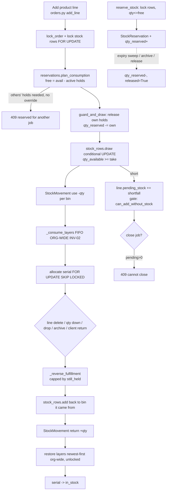
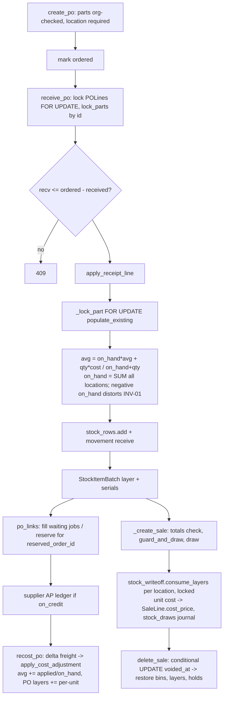
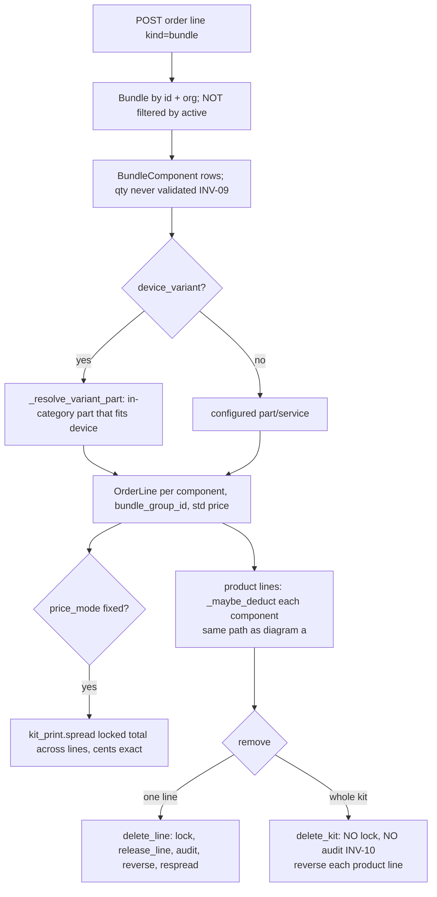
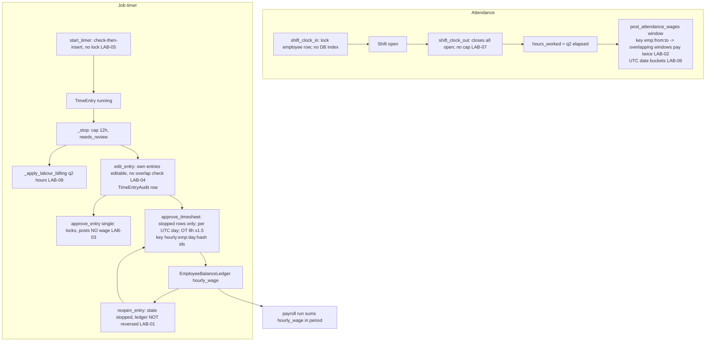

# 04 — Inventory, products, bundles, labour and time

Snapshot: `audit-src` = `roadmap/orderry-parity` @ d353c67b. All paths below are relative to that tree.
Probes: `scratchpad/audit/probes_inv/test_probe_inv_lab.py` (throwaway SQLite, loaded with `-p backend.tests.conftest`). The source tree was not modified (`git status` clean after runs).

**Counts:** CRITICAL 0 · HIGH 5 · MEDIUM 8 · LOW 6.

---

## Prior audit items (2026-10-29)

| Item | Status | Evidence |
|---|---|---|
| **H1** returns with a foreign `part_id` | **FIXED** | `routers/returns.py:_create_return` L82-84 loads `Part` with `Part.org_id == current.org_id` → 404. ORM flush guard `backend/db/tenancy.py:_guard_cross_tenant_references` also refuses org-less child rows (`client_return_lines`, `stock_levels`, `stock_movements`) that point at another shop's `parts`. `tests/test_audit_high_fixes.py::test_return_cannot_restock_another_shops_part` passes. *test-verified (existing test)* |
| **H2** foreign product on job → PO → receive/recost | **FIXED** | `order_lines.ref_id` is a soft ref checked by `tenancy._SOFT_REFS` (L134). `inventory.py:receive_po` L2117-2124 and `recost_po` L1983 load `Part` with `Part.org_id`; a stray foreign PO line gives 404. Tests `test_job_line_cannot_point_at_another_shops_part`, `test_receive_cannot_change_another_shops_part_even_with_a_stray_po_line` pass. *test-verified* |
| **H3** foreign serial in write-off/supplier return | **FIXED** | `stock_docs.py:create_return` L271-274 and `create_write_off` L455-458 filter `SerializedItem` by `org_id` and `part_id`; reverts at L346-349 and L572-575 do the same. `test_write_off_cannot_touch_another_shops_serial_unit` passes. *test-verified* |
| **M2** transfer lines with a foreign product | **FIXED** | `transfers.py:create_transfer` L333-336: `require_location` ×2 + `require_owned_ids(Part, …)`; per-line `Part.org_id` (L340-343). `test_transfer_cannot_carry_another_shops_part` passes. *test-verified* |
| **M4** double complete/cancel/delete (stock part) | **FIXED** for the listed stock paths | `transfers.py:change_status` L398 `claim_status(db, t, prev, new)` before any stock moves; `stock_docs.py:delete_return` L337 and `delete_write_off` L562 use `claim_status`; stocktake post uses a conditional `UPDATE … status != 'posted'` (`sales.py:post_stocktake` L1386-1390). `test_audit_m3_m4_cash_stock_races.py` passes (6 Postgres-only cases skipped). The cash half of M4 is out of scope here. **Not covered by M4's fix:** `edit_write_off_line` (INV-05) and `delete_kit` (INV-10). |

Regression run (SQLite): `test_audit_high_fixes`, `test_audit_m3_m4_cash_stock_races`, `test_stock_integrity`, `test_stock_atomic`, `test_avg_cost_concurrent_receipts`, `test_clock_in_once`, `test_144ay_timeentry_audit`, `test_kit_delete_whole`, `test_144co_bundle_integrity` → **68 passed, 6 skipped** (the skipped ones are `pg_only`).

---

## Answers to the brief's questions

- **Stored vs derived on-hand.** On-hand is stored (`stock_levels.qty_available`, `qty_reserved`, Float, no CHECK ≥ 0, `models/__init__.py:1295-1314`). Movements (`stock_movements`) are an audit trail; nothing reconciles them against the stored figure, and at least two paths change one without the other (INV-06, INV-12).
- **Can stock go negative?** Yes. `stock_rows.draw(…, allow_short=True)` books the shortfall on the unbinned row. Its only callers are stocktake posting (`sales.py:1424,1427`) and import undo, which does a raw `sl.qty_available -= qty` (`services/importer.py:1190`). Probe: a count, then a write-off, then posting the count gives **−1 on hand** (INV-01). Sales, job consumption, write-offs and transfers use the guarded draw and cannot go below zero.
- **Two users taking the last unit.** `stock_rows.draw` L168-171 is a conditional `UPDATE stock_levels SET qty_available = qty_available - :t WHERE id=:id AND qty_available >= :t`, checked by rowcount, retried up to 5 times. Job consumption first locks the rows with `FOR UPDATE` (`stock_consume.lock_rows`). Reservations lock the rows before counting (`inventory.py:reserve_stock` L1207). Serial allocation uses `FOR UPDATE SKIP LOCKED` (`services/serialized.py:93`). Code-read: safe. SQLite serialises writers, so the existing race tests prove nothing there; the `pg_only` races were skipped. **Needs Postgres/staging** to prove.
- **When is stock deducted and restored?** See diagram (a). Job line: deducted on add/merge/qty-up/convert/PO receipt (`orders.py:_maybe_deduct` → `_consume_from_bins`). Restored on line delete (L5423), kit delete (L5467), qty down (L5352), drop status (L1557), archive (L3711) and client return (`returns.py:98`), all through `_reverse_fulfillment`, capped by what the job still holds. Each of these is under `lock_order`, except `delete_kit`. Sales: deducted in `_create_sale`, restored on void (claimed by conditional UPDATE) and on returns. **No double-deduct path was found.** No never-restore path was found either, except that a posted stocktake shortage cannot be undone (by design).
- **Reservations vs on-hand.** `qty_reserved` is a running sum on the unbinned row, and `stock_reservations` holds the per-order detail. They drift in two places. `merge_parts` moves `qty_reserved` to the target but leaves `StockReservation.part_id` on the source (INV-04). A stocktake can count stock below what is reserved, and nothing clamps it.
- **Serial state machine.** `in_stock → allocated_to_order` (job) / `sold` (sale) / `in_transit` (transfer ready) / `written_off` (write-off, supplier return, stocktake shortage, transfer missing). Reverse paths: `_reverse_fulfillment`, `_unsell_serials`, write-off revert, transfer cancel, stocktake "found". A DB partial unique index stops two live units with one serial: `uq_serialized_items_live_serial (org_id, upper(replace(serial_number,' ','')))` WHERE status IN ('in_stock','allocated_to_order'). Edge case: reverting a write-off flips the unit back to `in_stock` without checking it is still `written_off` (`stock_docs.py:577`). If a stocktake had already "found" it, the aggregate is restored twice (LOW, folded into INV-05).
- **Average cost under concurrency.** `stock_posting._lock_part` takes `SELECT … FOR UPDATE` with populate_existing, and multi-line documents lock parts in id order (`lock_parts`), so receipts serialise. It is correct only while on-hand ≥ 0. With negative on-hand the WAC formula weights a negative quantity (INV-01, test-verified: avg 10 → **30** after receiving 2 @ 20).
- **Transfer and stocktake idempotency.** Yes, through `claim_status` and the conditional UPDATE (see M4). `receive_lines` on a transfer is not locked against `completed` (INV-13).
- **Cross-tenant product/location id on stock writes.** The ORM flush guard covers `stock_levels`/`stock_movements` inserts and updates through ORM, and every router I read scopes `Part` by org. Gap: `stock_rows.row_for` creates rows with Core `insert_ignore` (`stock_rows.py:80`) and `stock_rows.draw/add` update via Core `update(StockLevel)`. Neither is seen by the flush guard. Today every caller passes an org-checked part, and the location is checked through `require_location`/`guard_action`/`current.location_id`. No exploitable path was found (*code-read*), but the guard is not a safety net for these writes.
- **Double clock-in.** Attendance `shift_clock_in` locks the employee row (`FOR NO KEY UPDATE`, `timeclock.py:100`). There is no DB constraint (`shifts` has no partial unique index), and clock-out closes leaked duplicates. The job timer `start_timer`/`switch_timer` is check-then-insert with no lock and no index (LAB-05).
- **Overlapping entries.** Manual create checks for overlap without a lock. Edit (incl. own entries), `/api/v1/time-entries` and the running-timer race do not check at all (LAB-04).
- **Who edits closed entries; audited?** Approved entries are locked; `reopen` needs `can_manage_payroll` and is audited (`TimeEntryAudit`). Before approval, **an employee can edit or void their own entries**, which is audited but not blocked (LAB-04). Reopening does **not** reverse the posted wage (LAB-01). Attendance `shifts` have **no edit endpoint and no audit at all**; correcting one means editing the DB.
- **Timezone of totals.** Overtime per day, payroll days and the attendance window all bucket by the **UTC date** of `started_at` (LAB-06).
- **Rounding of labour minutes to money.** Billing: `hours = q2(duration_sec/3600)`, then `total = q2(hours*rate)`, so each entry is rounded to 0.01 h (36 s) (`timeclock.py:_apply_labour_billing`). Payroll/cost uses unrounded `duration_sec/3600*rate` with `q2` on the day total (`_day_wage`). The two disagree by up to 18 s per entry (LAB-08).

---

## Findings

### INV-01 [HIGH] Stocktake posting drives stock negative, which then corrupts the moving average
- **Module:** stocktake / average cost
- **Tables/columns:** `stock_levels.qty_available`, `parts.avg_cost`, `stocktake_lines.variance`
- **Functions/APIs:** `routers/sales.py:post_stocktake` L1370-1457 (draw with `allow_short=True` L1424, L1427); `services/stock_rows.py:draw` L183-191; `services/stock_posting.py:apply_receipt_line` L68-73
- **Execution flow:** count 3 with a book of 5 → variance −2 is frozen at count time (`_mark_counted`). 4 are then written off, so the book is 1. Posting applies −2 with `allow_short`, so the unbinned row goes to −1. The next receipt computes WAC with `on_hand = −1`.
- **Evidence:** `taken = await stock_rows.draw(db, l.part_id, st.location_id, -l.variance, allow_short=True)`; `part.avg_cost = q4(((on_hand * old_avg) + (qty * unit_cost)) / denom)`.
- **Verification:** **test-verified**. `test_INV_stocktake_post_drives_stock_negative_and_wac`: on hand after post **−1.0**; receiving 2 @ 20 with avg 10 gives `avg_cost` **30** (the only unit left on the shelf cost 20). With on-hand −9 and a 10-unit receipt the formula gives 110; with −10 it divides by zero and falls back.
- **Why it's a problem:** negative stock is reachable through a normal workflow (count, then sales continue, then post). WAC weighted on a negative base inflates or deflates cost, and so COGS, margins, valuation and the markup-based price (`apply-markup`).
- **Real-world failure scenario:** a shop counts on Monday and posts on Friday after a busy week. Several products go negative, and the next PO receipt sets wildly wrong costs that then flow into every job's profit.
- **Recommended fix:** at posting, clamp the shortage to what is on hand now (`allow_short=False`, then book any rest as a 0-qty "count variance unresolved" note). Or re-read the book at post time and refuse when it moved by more than the variance. In `apply_receipt_line`, use `max(on_hand, 0)` as the weight. Add `CHECK (qty_available >= 0)` once the data is clean.
- **Fix dependencies/risks:** the existing W3-D design intentionally freezes the variance, so changing it needs a product decision. A CHECK constraint needs a backfill of existing negative rows first.

### INV-02 [MEDIUM] Job consumption and its reversal use cost layers org-wide, while sales and write-offs use per-location layers
- **Module:** cost layers / COGS
- **Tables/columns:** `stock_item_batches.qty_remaining`, `location_id`, `warehouse_id`
- **Functions/APIs:** `services/stock_consume.py:_consume_layers` L48-58 (filters only `org_id`, `part_id`); `routers/orders.py:_consume_from_bins` L5034 calls it; `_reverse_fulfillment` L4830-4912 restores newest layer first, across all locations, **without `FOR UPDATE`**; `routers/stock_docs.py:_deplete_batches_fefo` L102-127 filters by `warehouse_id` only, unlocked, float arithmetic
- **Execution flow:** a job at branch A draws FIFO layers that physically sit at branch B. A later sale or write-off at B uses `stock_writeoff.consume_layers` (per location), finds B's layers empty, and values the units at average cost. A line removal "restores" the newest layer anywhere. Write-off documents drain only the layers tagged with that warehouse, so layers with `warehouse_id` NULL are never drained.
- **Evidence:** `select(...).where(StockItemBatch.org_id == org_id, StockItemBatch.part_id == part_id, StockItemBatch.qty_remaining > 0)`. In `_reverse_fulfillment`: `layers = (await db.execute(select(StockItemBatch).where(... ) .order_by(StockItemBatch.received_at.desc()))).scalars().all()` with no lock.
- **Verification:** schema-level / code-read
- **Why it's a problem:** per-location layers stop matching per-location shelves, so exact COGS and branch valuation are wrong. The unlocked read-modify-write of `qty_remaining` in `_reverse_fulfillment` and `_deplete_batches_fefo` can lose an update under Postgres concurrency.
- **Real-world failure scenario:** a two-branch shop. Branch reports show stock value at one branch with no layers behind it, and margin per job swings depending on which branch received the stock first.
- **Recommended fix:** route every outflow through one layer service keyed by (part, location), locked, as `stock_writeoff.consume_layers` already is. Record the layers taken on the order line (as `SaleLine.stock_draws` does) and restore exactly those.
- **Fix dependencies/risks:** needs a per-line draw journal for job lines; there is no backfill for old lines.

### INV-03 [MEDIUM] Import undo hard-deletes movement history and cost layers and can drive stock negative
- **Module:** product import
- **Tables/columns:** `stock_movements`, `stock_item_batches`, `serialized_items`, `stock_levels.qty_available`
- **Functions/APIs:** `services/importer.py:undo` L1139-1191
- **Execution flow:** the undo is claimed by conditional UPDATE (good). It then `DELETE`s the import's `StockMovement`, `StockItemBatch` and `SerializedItem` rows, and sets `sl.qty_available = (sl.qty_available or 0) - s["qty"]` on the **first** row for (part, location).
- **Evidence:** `await db.execute(delete(StockMovement).where(... ref_type == "import" ...))` … `sl.qty_available = (sl.qty_available or 0) - s["qty"]`.
- **Verification:** code-read
- **Why it's a problem:** units that were sold or used since the import still get subtracted, so stock goes negative (unguarded, and ORM read-modify-write, so a concurrent draw is lost). Deleting movements removes the audit trail. Deleting serialized units that were sold or allocated orphans sale and job references. Stock is taken from an arbitrary row, which can be a bin row.
- **Real-world failure scenario:** a shop imports opening stock, sells for a week, notices one bad column and clicks Undo. Stock goes negative, sold IMEIs vanish from warranty lookups, and history no longer explains on-hand.
- **Recommended fix:** refuse the undo when any imported layer or serial has been consumed. Otherwise reverse through `stock_writeoff.write_off` (guarded, with movements) instead of deleting.
- **Fix dependencies/risks:** UI copy for "can't undo, stock already used".

### INV-04 [MEDIUM] Product merge strands reservations, keeps the wrong average cost and is unlocked
- **Module:** products
- **Tables/columns:** `stock_reservations.part_id`, `stock_levels.qty_reserved`, `parts.avg_cost`, `order_lines.ref_id`, `po_lines.part_id`, `bundle_components.ref_id`
- **Functions/APIs:** `routers/inventory.py:merge_parts` L2616-2712
- **Execution flow:** each source `StockLevel` is folded into the target row via atomic add, then `sl.qty_available = 0` through the ORM. Movements, units and batches are repointed. `StockReservation`, open `POLine`, `BundleComponent` and job lines are **not** repointed. `target.avg_cost` is not re-weighted. No part or stock rows are locked.
- **Evidence:** the loop only covers `StockLevel`, `StockMovement`, `SerializedItem` and `StockItemBatch`. There is no `StockReservation` or `avg_cost` write in the function.
- **Verification:** code-read
- **Why it's a problem:** the target's `qty_reserved` rises while the hold rows still say `part_id = source`. Releasing or expiring them decrements the (now 0) source rows, so the target's reserved figure is stuck forever and blocks sales and transfers. Source units are revalued at the target's average. A sale drawing the source between read and `= 0` is lost (Postgres). An open PO later receives into the archived source.
- **Real-world failure scenario:** dedupe two "iPhone 12 screen" products while one is reserved for a job. Afterwards the merged product shows 1 reserved that nobody can release.
- **Recommended fix:** lock both parts and their stock rows, repoint reservations, open PO lines and kit components, and recompute `avg_cost` as the qty-weighted mean.
- **Fix dependencies/risks:** low.

### INV-05 [MEDIUM] Editing a write-off line is unlocked and can race a revert; serialized lines can change qty without units
- **Module:** write-off documents
- **Tables/columns:** `write_offs.status`, `write_off_lines.qty`, `stock_levels.qty_available`, `serialized_items.status`
- **Functions/APIs:** `routers/stock_docs.py:edit_write_off_line` L506-551; `delete_write_off` L554-584
- **Execution flow:** edit reads `doc.status` and `ln.qty` without a lock. Two edits 5→10 each take 5 more stock while `ln.qty` ends at 10, so 5 units vanish. An edit concurrent with a revert: the revert restores the old `ln.qty`, the edit takes the delta, and the doc ends reverted but stock is short. On a serialized line, changing qty from 1 to 3 draws 2 anonymous units, leaving their serials `in_stock`. Revert flips the unit to `in_stock` without checking its current status.
- **Evidence:** `doc = (await db.execute(select(WriteOff).where(...))).scalar_one_or_none()` (no `with_for_update`, no `claim_status`); `delta = data.qty - ln.qty`.
- **Verification:** code-read. Needs Postgres to reproduce the race.
- **Why it's a problem:** permanent stock loss, and units that no longer match the aggregate.
- **Recommended fix:** lock the `WriteOff` row (`FOR UPDATE`) and re-check status in edit. Compute the delta from a locked `WriteOffLine`. Refuse qty edits on lines with `serialized_item_id` or on serialized parts.
- **Fix dependencies/risks:** none.

### INV-06 [MEDIUM] A client return without an order adds unlimited stock with no cost layer and no source document
- **Module:** returns
- **Tables/columns:** `client_returns`, `stock_levels`, `stock_item_batches`, `parts.avg_cost`
- **Functions/APIs:** `routers/returns.py:_create_return` L108-117
- **Execution flow:** `order_id` omitted → `stock_rows.add(db, li.part_id, loc_id, li.qty)` plus a `return` movement. There is no link to a sale, no cap, no `StockItemBatch`, no WAC update. Gated only by `can_create_returns` (front desk).
- **Evidence:** `if li.restock and li.qty > 0: … await stock_rows.add(db, li.part_id, loc_id, li.qty)`.
- **Verification:** code-read
- **Why it's a problem:** any front-desk user can create stock out of nothing (also a theft-cover vector). Layers no longer cover the shelf, so those units are costed at average when used.
- **Real-world failure scenario:** a clerk "returns" 10 phone cases to hide a stock shortage. Inventory reports look fine and the count variance disappears.
- **Recommended fix:** require `order_id` or a `sale_id` with a returned-qty cap (sales already have `_return_sale_items`). Or require `can_manage_inventory` for free-standing returns and create a cost layer at average cost.
- **Fix dependencies/risks:** product decision on walk-in returns.

### INV-07 [LOW] Asset-to-product conversion adds stock with no movement and no cost layer
- **Module:** conversion
- **Tables/columns:** `stock_levels`, `stock_movements`, `stock_item_batches`
- **Functions/APIs:** `services/conversion.py` L284-298
- **Execution flow:** a `SerializedItem` is created with `unit_cost`, then `stock_rows.add(db, part.id, loc, 1, bin_id=unit.bin_id)`. No `StockMovement`, no `StockItemBatch`, no WAC.
- **Evidence:** `await stock_rows.add(db, part.id, loc, 1, bin_id=unit.bin_id)` with no `db.add(StockMovement(` in the block. (`routers/assets.py:717` does write a movement.)
- **Verification:** code-read
- **Why it's a problem:** on-hand cannot be explained from movements, and the unit has no layer.
- **Recommended fix:** use `stock_posting.apply_receipt_line(…, ref_type="asset", serials=[ident])`.
- **Fix dependencies/risks:** none.

### INV-08 [LOW] Purchase-return and write-off document movements carry no reference
- **Module:** stock documents
- **Tables/columns:** `stock_movements.ref_type`, `ref_id`
- **Functions/APIs:** `routers/stock_docs.py:create_return` L289-291, `create_write_off` L471-473, `edit_write_off_line` L538-541, reverts L355-358 / L580-583
- **Execution flow:** each of these writes a `StockMovement` without `ref_type` or `ref_id`.
- **Evidence:** `StockMovement(part_id=…, movement_type="writeoff", qty=-ln.qty, created_by_id=current.id)`.
- **Verification:** code-read
- **Why it's a problem:** a movement cannot be traced to the document that caused it.
- **Recommended fix:** set `ref_type="write_off"|"purchase_return"`, `ref_id=doc.id`.
- **Fix dependencies/risks:** none.

### INV-09 [LOW] Bundle component quantities are not validated; a bad kit 500s when added to a job
- **Module:** bundles
- **Tables/columns:** `bundle_components.qty`
- **Functions/APIs:** `routers/bundles.py:CompIn` L98-102, `_validate_components` L48-56; `orders.py` kit explode L4693 builds `LineIn(qty=c.qty * data.qty)`
- **Execution flow:** CompIn has no qty check, so a 0, negative or fractional `pcs` qty is saved. On add, `LineIn._qty_positive` raises a pydantic `ValidationError` inside the handler, which surfaces as a 500. An inactive bundle can also still be added (no `Bundle.active` filter at L4655).
- **Evidence:** `qty: float = 1` with no validator.
- **Verification:** code-read
- **Recommended fix:** `Field(gt=0)` plus `check_whole` per component, and filter `Bundle.active`.
- **Fix dependencies/risks:** none.

### INV-10 [LOW] `delete_kit` takes no job lock and writes no audit, unlike single-line delete
- **Module:** bundles on jobs
- **Functions/APIs:** `routers/orders.py:delete_kit` L5440-5472 (compare `delete_line` L5401 `_lock_for_lines`, L5428 `release_line`, L5429 `_audit_line`)
- **Execution flow:** the lines are read unlocked, `_reverse_fulfillment` runs per line, then `db.delete`. Two concurrent kit deletes both restore stock. On Postgres the second one usually fails at flush with `StaleDataError` (0 rows deleted) and rolls back, so it is a 500 rather than a double restore. It still depends on that accident.
- **Verification:** code-read
- **Recommended fix:** `await _lock_for_lines(db, order)` and re-read the lines; audit each line removed.
- **Fix dependencies/risks:** none.

### INV-11 [LOW] Transfer `receive_lines` is not locked against `completed`
- **Module:** transfers
- **Functions/APIs:** `routers/transfers.py:receive_lines` L563-605 (status check unlocked); `change_status` reads lines before `claim_status`
- **Execution flow:** a receive and a complete run concurrently. Complete credits the full shipped qty, and the receive then writes `qty_received = 9` on a completed transfer.
- **Verification:** code-read
- **Recommended fix:** lock the transfer row (`FOR UPDATE`) in receive and re-check status; in complete, re-read lines after the claim.
- **Fix dependencies/risks:** none.

### LAB-01 [HIGH] Reopening an approved time entry leaves its wage posted: re-approval pays it again or silently drops the correction
- **Module:** timesheets → payroll
- **Tables/columns:** `time_entries.state`, `employee_balance_ledger (entry_type='hourly_wage', idempotency_key)`
- **Functions/APIs:** `routers/timeclock.py:reopen_entry` L776-797 (no ledger reversal); `approve_timesheet` L1031-1103; key at L1075/L1093 `hourly:{emp}:{day}:{sha(sorted entry ids)}`
- **Execution flow:** approve {A,B} posts the wage for the day. Reopen A sets it to `stopped` and leaves the ledger untouched. Re-approve: `rows={A}`, `already={B}`, wage = day_wage(B+A) − day_wage(B) = A's wage, with a new batch key, so it **posts again**. If A was the only entry, the batch key equals the original, so a corrected wage is **not** posted, but the response still says `wage_posted: 190`.
- **Evidence:** `reopen_entry` only does `e.state = "stopped"; e.approved_by_id = None`.
- **Verification:** **test-verified**. `test_LAB_reopen_one_of_two_pays_it_again`: ledger **180** (correct 120). `test_LAB_reopen_reapprove_pays_entry_twice`: a correction from 8h to 9h leaves the ledger at **160**, with response `"wage_posted":190.0,"ledger_posted":false`.
- **Why it's a problem:** the documented correction flow (reopen → fix → approve) either double-pays or underpays, and the API reports a wage it did not post.
- **Real-world failure scenario:** a manager fixes one tech's forgotten clock-out on a day with two entries. The tech is paid for that entry twice on the next run.
- **Recommended fix:** on reopen, post a reversing `hourly_wage` entry for that entry's share (or store `wage_ledger_id` per entry and void it). Key the wage per entry plus a version instead of per batch, and return `wage_posted` only when posted.
- **Fix dependencies/risks:** if the run is already paid, a reversal must go into the next period (payroll adjustment).

### LAB-02 [HIGH] Attendance wages for overlapping windows pay the same shifts twice
- **Module:** payroll / attendance clock
- **Tables/columns:** `shifts.hours_worked`, `employee_balance_ledger.idempotency_key`
- **Functions/APIs:** `routers/payroll.py:post_attendance_wages` L967-1013; key at L1001 `attendance:{emp}:{date_from}:{date_to}`
- **Execution flow:** POST 1–15, then POST 1–31. The keys differ, both windows include the same shifts, and both post.
- **Evidence:** `idem = f"attendance:{data.employee_id}:{data.date_from}:{data.date_to}"` is the only dedupe; shifts carry no "paid" marker.
- **Verification:** **test-verified** (`test_LAB_attendance_overlapping_windows_double_pay`): one 8h shift at 20/h gives a ledger of **320** (correct 160); both calls return 201 with `ledger_posted: true`.
- **Why it's a problem:** direct overpayment. The labour-timesheet path was fixed for this exact pattern (batch A, "wider window"), but the attendance path was not.
- **Recommended fix:** mark shifts as paid (`paid_ledger_id`), or price per shift with a per-shift key, as approve_timesheet does per day and entry.
- **Fix dependencies/risks:** backfill of shifts already paid.

### LAB-03 [HIGH] An entry approved one at a time is never paid
- **Module:** timesheets → payroll
- **Functions/APIs:** `routers/timeclock.py:approve_entry` L734-753 (sets `approved`, posts nothing); `approve_timesheet` L1044-1048 (only `state=='stopped'` rows are priced; `approved` rows are the "before" baseline)
- **Execution flow:** a manager clicks Approve on one entry, then runs timesheet approval for the week. That entry is excluded from `rows`, and its pay is subtracted as already paid. If it was the only entry, the response is 404 "No stopped entries".
- **Verification:** **test-verified** (`test_LAB_single_entry_approve_is_never_paid`): ledger **0** (expected 160); timesheet approve returns 404.
- **Why it's a problem:** silent underpayment, with an approval UI that looks complete.
- **Recommended fix:** make `approve_entry` post the entry's wage through the same per-day pricing, or have it only "lock" with a separate `paid` flag that `approve_timesheet` prices.
- **Fix dependencies/risks:** entries already approved singly need a backfill run.

### LAB-04 [HIGH] Employees can lengthen or overlap their own time before approval; edit and API skip the overlap check
- **Module:** time clock
- **Functions/APIs:** `routers/timeclock.py:edit_entry` L667-710 (`_can_manage_emp` is True for one's own entries, L570-573; no overlap check; no `AUTO_STOP_HOURS` cap); `void_entry` L713-731; `create_manual` overlap check L631-637 (unlocked); `routers/v1.py:create_time_entry` L798-827 (no overlap check)
- **Execution flow:** a tech PATCHes `ended_at` on their own stopped entry from 11:00 to 20:00, overlapping another entry. It is accepted, and `_overtime_split` sums overlapping hours.
- **Verification:** **test-verified** (`test_LAB_tech_extends_own_entry_overlapping`: 200, expected 409). It is audited in `time_entry_audits`.
- **Why it's a problem:** payable hours are self-declared and overlapping time is paid twice. A manager approving a weekly batch sees only totals. The audit trail exists, but nothing flags the change.
- **Real-world failure scenario:** a tech adds two hours to each day; approval runs weekly in bulk; overtime is paid at 1.5×.
- **Recommended fix:** restrict own edits to `note` (or route them through `dispute`), require `can_manage_payroll` to change times, run the overlap check on edit and the v1 API, and set `needs_review` on any self-edit.
- **Fix dependencies/risks:** product decision on self-service corrections.

### LAB-05 [MEDIUM] Job timer start/switch is check-then-insert: double tap → two running timers
- **Module:** time clock
- **Tables/columns:** `time_entries (employee_id, state='running')` (no partial unique index)
- **Functions/APIs:** `routers/timeclock.py:start_timer` L298-360 (`_running_for` L257 then insert, no lock); `switch_timer` L409-431 (also skips `_clock_enabled`)
- **Execution flow:** two concurrent starts both see no running timer and both insert. `_running_for(...).first()` stops only one, and the other runs to the 12 h auto-stop.
- **Evidence:** the docstring says "At most one 'running' entry per employee", but this is enforced only by code. Compare the attendance clock-in, which locks the employee row (L100).
- **Verification:** code-read. **Needs Postgres** (SQLite serialises).
- **Recommended fix:** a partial unique index on `time_entries(employee_id) WHERE state='running'`, plus the same employee-row lock as `shift_clock_in`.
- **Fix dependencies/risks:** clean up existing duplicates before adding the index.

### LAB-06 [MEDIUM] Daily overtime and payroll windows use UTC dates, not the shop's
- **Module:** payroll hours
- **Functions/APIs:** `routers/timeclock.py:_overtime_split` L956-968 and `approve_timesheet` L1052 (`e.started_at.date()` on naive UTC); `_udt` L24 (a bare date is read as UTC midnight); `routers/payroll.py:post_attendance_wages` L994-997 (`func.date(Shift.started_at)`)
- **Execution flow:** in a UTC−5 shop, an evening shift of 15:00–23:00 local becomes 20:00–04:00 UTC and is split across two "days", so the 8h overtime threshold is never reached. A shift starting at 21:00 local on the 31st counts in next month's window.
- **Verification:** code-read
- **Recommended fix:** bucket by `shop_today`/`today_in(shop_tz)` (both helpers already exist in `services/dates`), and convert window bounds with `day_start_utc`.
- **Fix dependencies/risks:** changing buckets moves historical overtime; apply from a cut-over date.

### LAB-07 [MEDIUM] Attendance shifts cannot be corrected and have no audit
- **Module:** attendance clock
- **Tables/columns:** `shifts` (no `org_id`, no audit table)
- **Functions/APIs:** only `shift_clock_in` / `shift_clock_out` / history / roster exist (`timeclock.py` L83-190); a grep of `routers/` finds no other Shift writer
- **Execution flow:** a forgotten clock-out accrues hours until the employee next clocks out. Clock-out then closes it at "now" with `hours_worked` set to the full elapsed time (no cap like the job timer's 12 h).
- **Verification:** code-read
- **Why it's a problem:** attendance-paid staff (`hourly_basis='attendance'`) get paid for a forgotten weekend. The only fix is a manual DB edit, with no trail.
- **Recommended fix:** a manager edit endpoint with an audit row, and an auto-cap plus a `needs_review` flag mirroring `_stop`.
- **Fix dependencies/risks:** `shifts` has no `org_id`, so add one for tenant scoping.

### LAB-08 [LOW] Labour billing rounding differs from payroll; billing failures are swallowed
- **Module:** labour billing
- **Functions/APIs:** `routers/timeclock.py:_apply_labour_billing` L456-507
- **Evidence:** `hours = q2((e.duration_sec or 0) / 3600.0)`; `total = q2(hours * rate)`; `except Exception: pass`. Payroll uses unrounded seconds (`_day_wage`).
- **Verification:** code-read
- **Why it's a problem:** each entry is billed at 0.01 h steps. If anything fails (e.g. a locking invoice), the labour line silently does not follow the time, with no log.
- **Recommended fix:** bill `round(duration_sec * rate / 3600, 2)`, and log the exception.
- **Fix dependencies/risks:** none.

---

## Orderry rule checks (section 4, Q1–8)

| # | Rule | Answer | Evidence |
|---|---|---|---|
| 1 | Every `stock_levels` change paired with a `stock_movements` row in the same transaction | **NO** | Most paths pair them: posting `stock_posting.py:79-85`, sale `sales.py:597`, job `orders.py:5022`, transfer, stocktake, bins `bins.py:351-357`. Exceptions: asset conversion `services/conversion.py:298` (no movement, INV-07); import undo **deletes** movements (`importer.py:1186-1190`, INV-03); merge moves `qty_reserved`/`qty_available` between parts with no movement (`inventory.py:2671-2675`); reserve/release change `qty_reserved` with no movement (only overrides log a 0-qty `reserve_override`). |
| 2 | One receive/posting service, one WAC basis | **YES** | `services/stock_posting.apply_receipt_line` is used by postings (`inventory.py:_do_posting`), adjust-in, PO receive (`inventory.py:2156`). Only two `avg_cost` writers exist, both in that module (L73, L169). WAC is global over all locations. One `receive_po` (`inventory.py:2073`); the stock_docs posting engine was removed (`stock_docs.py:587-589`). Caveat: WAC is wrong on negative on-hand (INV-01). |
| 3 | Reserve/deduct race-safe; no over-reserve | **YES** (Postgres; code-read) | `reserve_stock` locks the rows then checks `qty > free` (`inventory.py:1207-1211`); deducts use a conditional UPDATE (`stock_rows.py:168-174`); `reservations.guard_and_draw` blocks others' holds. The SQLite tests can't prove it; `pg_only` races were skipped. Caveat: a stocktake can lower on-hand below `qty_reserved`. |
| 4 | Posting delete refused after consumption; WriteOff/ClientReturn deletes write compensating movements | **PARTIAL** | Postings have **no delete/revert endpoint** (nothing to check). WriteOff delete is a soft `reverted` status plus `writeoff_reverted` movements (`stock_docs.py:554-584`), but it doesn't check whether the units were re-used. ClientReturn has no delete endpoint. Import undo (the de-facto "delete a posting") ignores consumption and deletes history (INV-03). |
| 5 | Stocktake posted as a document with movements, never direct overwrites | **YES** | `post_stocktake` applies signed variances via `stock_rows.add/draw` plus an `adjust` movement with `ref_type='stocktake'` per line (`sales.py:1404-1446`). Caveat: it can go negative (INV-01). `bulk_adjust` "set_qty" also goes through adjust/write-off with movements (`inventory.py:863-900`). |
| 6 | "Without deduction" gated and reconciled before close | **YES** (default-allow) | `_maybe_deduct` refuses a shortfall only when `perms.get("can_add_without_stock") is False` (`orders.py:4993`). That is an explicit deny; unset means allowed. Closing with `pending_stock > 0` gives 409 (`orders.py:1828-1835`). |
| 7 | Serial uniqueness by DB index | **YES** | `uq_serialized_items_live_serial` unique on `(org_id, upper(replace(serial_number,' ','')))` WHERE status IN ('in_stock','allocated_to_order') (`models/__init__.py:2386-2389`). `in_transit` units are not covered by the index. |
| 8 | One unique `stock_levels` row per (org, part, location/warehouse, bin) | **YES, with a caveat** | `uq_stock_levels_part_bin (part_id, bin_id)` WHERE bin_id NOT NULL and `uq_stock_levels_part_loc_unbinned (part_id, location_id, coalesce(warehouse_id,''))` WHERE bin_id NULL (`models/__init__.py:1299-1304`, migration `ii144a01`). Org is implied by `part_id`. Addressing is still dual: unbinned rows exist per (location, warehouse tag), so one location can hold several unbinned rows. Readers must sum via `stock_rows.rows`, and `stock_docs._stock_rows` prefers warehouse-tagged rows, which can differ from the location sum. |

---

## Diagrams

### (a) Part on a work order: reserve → consume → cancel/return

### (b) PO → receive → average cost → sell

### (c) Bundle sale → component stock

### (d) Clock-in → out → correction → payroll

---

## 1. Inspected
- `backend/db/tenancy.py` (whole), `ARCHITECTURE.md` (tenancy), prior audit `docs/audits/2026-10-29-full-codebase-audit.md`.
- Services, read whole: `stock_posting`, `stock_consume`, `stock_rows`, `stock_writeoff`, `reservations`, `serialized`, `serial_log`, `valuation`, `stock_archive`, `labour`, `commission_input`; `money.add_to_column/claim_status`; `db/database.insert_ignore`.
- Routers, read in part (flows named above): `inventory.py` (adjust, scan-adjust, postings, bulk-adjust, reserve/release/expire, create_po, edit_po lines, recost, receive, merge), `stock_docs.py` (whole), `transfers.py` (create, status, receive), `returns.py` (create), `sales.py` (create, void, sell units, stocktake start/count/post/settle/discard), `orders.py` (`_maybe_deduct`, `_consume_from_bins`, `_reverse_fulfillment`, drop/reopen, archive stock block, add kit, delete_line, delete_kit, create-po), `bundles.py` (validation), `timeclock.py` (whole of shift, timer, entries, timesheet), `payroll.py:post_attendance_wages`, `v1.py:create_time_entry`, `services/importer.undo` (stock block), `services/conversion.py` (stock unit).
- Models: `Part`, `Service`, `Bundle`, `BundleComponent`, `StockLevel`, `StockMovement`, `SerializedItem` index, `Shift`, `TimeEntry`, `EmployeeBalanceLedger.idempotency_key`.

## 2. Not inspected
- `services/warehouses.py` (only `guard_action`/`resolve` call sites), `services/inventory_alerts.py` (low-stock dedupe flag `parts.low_stock_alerted` is a plain ORM write; race not checked), `services/product_codes.py`, `catalog_products.py`, `pricing.py` (price lists, variants pricing, markup), `serials.py`, `warehouses.py` router, `bins.py` beyond L351, `order_items.py`.
- `services/payroll.py` CommissionEngine and commission rules (only the labour input checks); technician assignment and per-line `technician_id` edits on closed jobs.
- `sales.py:_return_sale_items` (sale returns) beyond the void path; `po_links.apply_receipt_to_orders`; `services/job_returns.py`.
- Docs `docs/INVENTORY_STRATEGY.md`, `docs/INVENTORY_DETAIL_FLOWS.md`, `INVENTORY_PO_POSTINGS_AUDIT.md`: only to the extent restated by the code comments (Q2 answered from code).

## 3. Verified (by test/probe)
- Existing tests: 68 passed / 6 skipped (Postgres-only) across the 9 regression files listed above (H1, H2, H3, M2, M4 stock).
- New probes (`scratchpad/audit/probes_inv/test_probe_inv_lab.py`, SQLite):
  - INV-01: stock −1 after a stocktake post; WAC 10 → 30.
  - LAB-01: double pay (180 vs 120), and a dropped correction (160, with the response claiming 190).
  - LAB-02: 320 vs 160.
  - LAB-03: 0 vs 160.
  - LAB-04: an overlapping self-edit returned 200.

## 4. Uncertain
- INV-10's real impact on Postgres (whether it gives a StaleDataError 500 or a double restore depends on the flush ordering).
- Whether the product intends that W3-D frozen variances may drive stock negative (INV-01 severity rests on that).
- `stock_docs._stock_rows` warehouse-row preference vs. location sum in multi-warehouse-per-location shops (Q8 caveat).

## 5. Needs staging (Postgres) to test properly
- Last-unit races: job vs job, sale vs job, transfer-ready vs sale (conditional UPDATE + `FOR UPDATE`); the `pg_only` cases in `test_audit_m3_m4_cash_stock_races`, `test_clock_in_once`, `test_avg_cost_concurrent_receipts`.
- LAB-05 double timer start; INV-05 edit-vs-revert race; INV-04 merge vs concurrent sale; INV-02 lost layer updates in `_reverse_fulfillment` / `_deplete_batches_fefo`; INV-11 receive vs complete.
- Deadlock ordering across archive / reserve / transfer complete under load.
