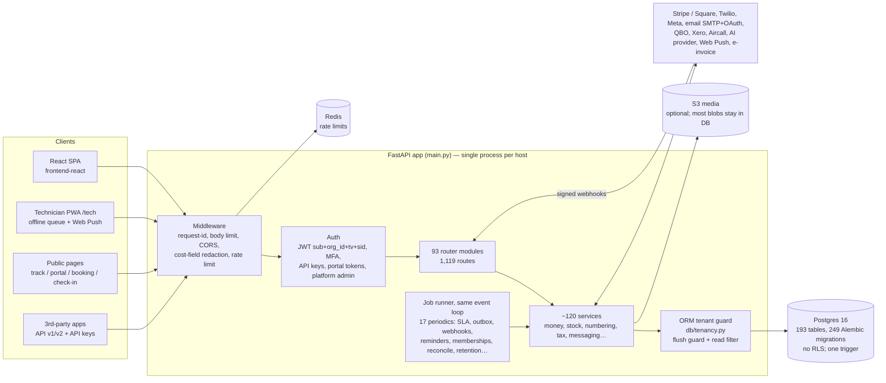
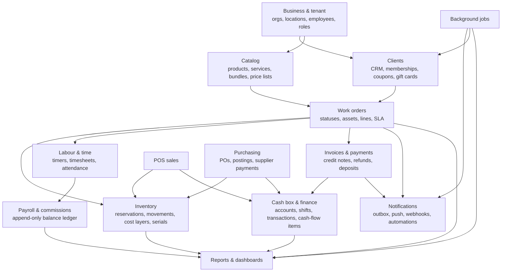

# Tekly backend audit, 12 Nov 2026 (read-only)

- **Snapshot audited:** `roadmap/orderry-parity` @ `d353c67b`. This is the newest merged beta code, read from a separate detached copy.
- **Nothing was changed:** no code, schema, migrations or data.
- **What the probes touched:** they ran only against throwaway SQLite databases created by the test suite. The demo Postgres and production were never touched.
- **What this folder holds:** this file is the central report and findings index. The detail reports sit next to it, and the probe tests that reproduce bugs are in `probes/`.

## 0. Verdict in one paragraph

**Shop isolation:** I found no way, through the API, for one shop to read or change another shop's data. Every prior cross-shop finding (H1–H4) is fixed, and an ORM guard backs the hand-written filters. **There are no CRITICAL findings.**

**Where the real risk is:** money and wages being recorded wrong in ordinary use:
- payroll pays some shifts twice and others never;
- a refund double-click books twice;
- deleting one leg of a client advance desynchronises the till.

The database itself enforces very little. Payments carry no shop id, nothing guarantees a single open drawer or a single running timer, there are zero CHECK constraints, and money comes back as floats. So these mistakes are possible, and the nightly reconcile sweep catches only some of them.

**19 HIGH findings, all fixable without redesign.** Ten of them are reproduced by a test. The fixes split into three groups:
- payroll (5);
- money idempotency/legs (2);
- work-order side effects (3).

## 1. Counts

| Area | Report | High | Medium | Low | Total |
|---|---|---|---|---|---|
| Tenancy, auth, RBAC, security | `01-tenancy-security.md` | 2 | 6 | 5 | 13 |
| Database schema & constraints | `02-schema-findings.md` | 2 | 10 | 6 | 18 |
| Money, cash box, invoices, tax | `03-money.md` | 2 | 8 | 7 | 17 |
| Inventory, products, bundles, labour, timeclock | `04-inventory-labour.md` | 5 | 8 | 6 | 19 |
| Work orders, notifications, jobs, clients | `05-workflows-notifications.md` | 4 | 10 | 4 | 18 |
| Performance, reports, scalability | `06-performance-api.md` | 4 | 21 | 6 | 31 |
| **Total** | | **19** | **63** | **34** | **116** (about 110 unique; overlaps noted in §5) |

Critical: **0**. Competitor research is in `00-competitor-orderry.md`; it is a reference and has no severities.

## 2. Deliverables map

| # | Deliverable | Where |
|---|---|---|
| 1 | System architecture diagram | §3 below, plus `01-tenancy-security.md` (request → guard flow) |
| 2 | Database ER diagram | `02-er-diagram.md` (one diagram per domain, plus a relationship map) |
| 3 | Table inventory (193 tables) | `02-schema-inventory.md` |
| 4 | Table relationship map | `02-er-diagram.md` (end) |
| 5 | Tenant isolation audit | `01-tenancy-security.md`, `02-schema-findings.md` DB-01–03, DB-13 |
| 6 | Module dependency map | §4 below |
| 7 | API & backend function inventory (1,119 routes, 17 periodic jobs) | `06-api-inventory.md`, `06-performance-api.md` §1 |
| 8 | Critical workflow diagrams | Spread across three reports (list below) |
| 9 | Query performance | `06-performance-api.md` |
| 10 | Financial & inventory integrity | `03-money.md`, `04-inventory-labour.md` |
| 11 | Security | `01-tenancy-security.md` |
| 12 | Scalability | `06-performance-api.md` (PERF-16–23) |
| 13 | Missing constraints, indexes and validations | `02-schema-findings.md` DB-04–10, DB-13, plus §5 below |
| 14 | Broken or incomplete implementations | §5 below (the HIGH list), plus §6 |
| 15 | Prioritised remediation roadmap | §7 below |
| + | Competitor (Orderry) model, rules, and 31 yes/no checks answered | `00-competitor-orderry.md`, plus the "Orderry rule checks" sections in 01/03/04/05 |

Workflow diagrams (deliverable 8):
- `05-workflows-notifications.md`: the end-to-end work-order trace, from client selection through work order, lines, labour, parts, status, notification, invoice, payment and cash, to reports;
- `03-money.md`: invoice → part payment → refund; POS sale with coupon and membership → cash; shift open → close;
- `04-inventory-labour.md`: part reserve → consume → cancel; PO → receive → average cost; bundle stock; clock-in → payroll.

## 3. Architecture (as built)

How tenancy works:
- Every JWT carries `org_id`, and `get_current_employee` puts it on the session.
- The **flush guard** refuses to write a row, or a link, that belongs to another shop.
- The **read guard** adds `org_id = :tenant` to every ORM SELECT on an `OrgScoped` model.
- Postgres row-level security is **not** used.
- The guard does **not** cover:
  - 29 tables with no `org_id` (payments, order/invoice/sale lines, stock levels/movements, cash shifts…);
  - `text()` SQL;
  - Core statements;
  - identity-map hits;
  - about 80 loose `*_id` columns that have no foreign key.

  These tables are safe today only because every call site goes through a parent row that is scoped (SEC-01, DB-01–03, DB-13).

## 4. Module dependency map

There is no budget or financial-planning module. The only "planned vs actual" is staff hours in `routers/schedules.py`, so module K is **not built**.

## 5. Central findings index (all HIGH, plus the MEDIUMs that matter most)

The full evidence for each ID is in its report: file:line, tables, flow, verification level, fix and fix risk. "Test" means a scratchpad probe reproduced it; "code" means it was confirmed by reading the code.

### HIGH (19)

| ID | Module | Finding | Verified |
|---|---|---|---|
| LAB-01 | Payroll | Reopening an approved time entry leaves its wage posted. Re-approval pays it again (ledger 180 vs 120). | test |
| LAB-02 | Payroll | Attendance wages over overlapping windows (1–15, then 1–31) pay the same shift twice (320 vs 160). | test |
| LAB-03 | Payroll | An entry approved one at a time is never paid; timesheet approval treats it as already paid (ledger 0 vs 160). | test |
| LAB-04 | Timeclock | Staff can lengthen or overlap their own stopped entries; the edit path and the v1 API skip the overlap check, so overlapping hours get paid. | test |
| RPT-01 | Payroll/reports | Timesheet days and overtime are counted on UTC days, and the date window is read as UTC. A New York shop got 8.0 h and 0 OT instead of 10.5 h and 2.5 h OT. Wages post from this. (Same family as LAB-06.) | test |
| FIN-01 | Money | `POST /api/returns/refunds` and `/api/cash/orders/{id}/refund` have no idempotency or double-click guard. The same refund, even with the same Idempotency-Key, books twice and cash leaves the till twice. | test |
| FIN-02 | Cash | The cash leg of a client advance, payout or supplier payment can be deleted or restored on its own. The till drops while the client keeps the credit, and the reconcile sweep reports nothing. | test |
| INV-01 | Inventory | Posting a stocktake after sales continued drives stock to −1, and the next receipt's moving average is wrong (30 vs 20). | test |
| WO-01 | Work orders | Re-sending the same status re-runs every side effect: the customer is messaged again (3 PATCHes gave 3 emails), and `closed_at`, the SLA clock and warranty are reset. | test |
| WO-02 | Work orders | `POST /api/timeclock/order/{id}/bill` has no permission check, trusts the rate sent by the client, works on closed jobs, and never marks time as billed. Billing the same hour twice took a Done job from 0 to 100. | test |
| NTF-01 | Notifications | `push.notify(commit=False)` still commits the caller's half-finished transaction when a real Web Push is sent, so a half-built job can be committed. | test |
| CLI-01 | Tenant mgmt | A suspended shop keeps sending SMS and email, billing memberships and running automations and webhooks. Only staff sign-in is blocked, and public booking and check-in stay open. | test |
| SEC-01 | Tenancy | 29 tables (payments, order/invoice/sale lines, stock tables, cash shifts) sit outside both tenant guards. No endpoint exploits this today, but it becomes CRITICAL the moment one does. | test (guard gap) / code (no exploit) |
| DB-01 | Schema | `payments` has no `org_id`; its owner is guessed from four optional links, and readers disagree on which one to use. The DB accepts a payment linked to nothing. | test |
| SEC-02 / FIN-05 | RBAC/cash | Restricting a role to some cash accounts only hides them from one list. `scoping.may_use_account` is never called, so transactions, transfers, pay and refund ignore the restriction. | code (re-checked by me) |
| DB-04 | Schema | "Only one open at a time" has no DB backing: one open drawer per location (existing shops already have doubles; see the comment at `finance.py:1068`), one running timer per employee (LAB-05 race), one membership per plan per asset. | code |
| PERF-01 | Public page | The public tracking page returns every client-visible photo inline as base64, with no size limit, polled every 20 s with no ETag. A probe measured 119.7 MB in one unauthenticated response. | test |
| PERF-02 | Media | The S3 media backend calls `boto3` synchronously inside async handlers (`services/media.py:76, 97`), which blocks the worker for every shop while it waits. | code (re-checked by me) |
| PERF-03 | Inventory | `parts.image_data` (up to 400 KB each) is loaded by 8 stock reports, the reorder list and `GET /api/inventory/parts`. | test |

### MEDIUM items most likely to bite in real operation

| ID | Finding |
|---|---|
| FIN-03 | Deleting a gift-card, coupon or loyalty discount line on a job doesn't restore the balance, the use or the points. |
| FIN-04 | Invoice "Record payment" takes cash with no account (no till entry) and accepts a closed drawer shift. |
| FIN-07 | Invoice payment locks the invoice and job payment locks the order, so both can fill the same balance (needs Postgres to prove). |
| FIN-06 | "Prevent backdating" isn't checked on manual invoices, and its comparison is wrong. |
| FIN-10 | A cash box with money in it can be deactivated, and its settings can be edited with only the view-finance right. |
| SEC-03 / SEC-04 | A "selected locations" role with nothing selected sees every location; changing an order's location is never checked; warehouse scope is enforced at only 6 call sites. |
| SEC-06 | 254 employee routes have no declarative permission gate. Among those with no inline check either: asset transfer, logging a customer reply, leads. |
| SEC-07 | Any shop can claim any email domain for SSO without proving ownership (phishing redirect today; there is no SSO callback yet). |
| SEC-05 | Several sweeps run with no shop context, and some share one session across shops. With no context, a child row's links aren't checked. |
| WO-03 | Work orders have no version column, so the last writer wins on header fields. |
| WO-05 | Seven other ways of creating a job skip notifications, commissions, automations, the audit row and the one-open-ticket asset rule. |
| WO-06 | `orders.status` is never validated against the shop's status list (no FK). |
| WO-08 / NTF-02 | Messages are queued after the business commit in a separate transaction, and the legacy path sends before commit. A message can be lost, or sent for a change that rolled back. |
| CLI-02 | A deactivated employee is still auto-assigned jobs and still gets pushes. |
| LAB-05 | Starting a job timer is check-then-insert, so a double tap gives two running timers. |
| LAB-06 / RPT-02–04 | Overtime, Insights, trends and attendance still bucket by UTC day (the bug class PR #200 fixed elsewhere). |
| INV-02 | Jobs draw cost layers org-wide, while sales and write-offs draw per location, so branch COGS drifts. |
| INV-03 / INV-04 | Import undo deletes movement history and can drive stock negative; product merge strands reservations. |
| DB-05 / DB-06 | Sale, transfer, write-off, purchase-return and posting numbers can repeat; coupon and gift-card codes can repeat (a duplicate gives a 500 at checkout). |
| DB-07 | There are zero CHECK constraints: negative amounts, negative stock and made-up statuses are all accepted. |
| DB-08 / FIN-14 | 63 `Float` columns; 95 `Numeric(asdecimal=False)` money columns come back as floats. |
| DB-09 | The nightly reconcile covers only 4 stored totals. Gift-card and supplier balances and order, sale and PO totals can drift unseen. |
| DB-10 | 208 of 525 FK columns and 29 `org_id` columns have no index, including `payments.shift_id`, which is summed at every drawer close. |
| DB-11 | Voiding a refund hard-deletes payment rows, matched by timestamp; manual entries in the "append-only" payroll ledger are hard-deleted. |
| PERF-07 / RPT-08 | Home dashboard: 65 SQL statements per load; "This month › Average job" is actually the all-time average. |
| PERF-14 | Search runs LIKE over nested `replace()`, so no index helps; two passes and an audit write per keystroke. |
| PERF-16–18 | Jobs share the web event loop and DB pool. The integrity sweep will hit the 15 s timeout at scale. Retention is opt-in and unbatched. |

Overlaps (counted once in the roadmap):
- SEC-02 = FIN-05;
- SEC-01 ⊃ DB-01, DB-02;
- RPT-01 ≈ LAB-06 ≈ RPT-04;
- DB-04 ⊃ LAB-05;
- DB-05 ⊃ FIN-17;
- DB-08 = FIN-14;
- PERF-09 follows from DB-01/02.

## 6. Prior audit (29 Oct) — status

| Item | Status |
|---|---|
| H1–H3 cross-shop product/serial ids, M2 transfers | **Fixed** in code (ORM guard plus ownership checks); the DB still has no composite FK (DB-03) |
| H4 manager self-escalation to "no role" | **Fixed** |
| H5 negative totals → cash refund | **Partly fixed:** floored at 0 and the redeem is locked; deleting a discount line still doesn't restore it (FIN-03) |
| M1 XSS, M5–M11 | **Fixed** |
| M3 restore a voided cash transaction | **Fixed** for document legs; client advance and supplier legs are still open (FIN-02) |
| M4 races | **Fixed** for cash and the listed stock paths; write-off line edit and kit delete are not covered (INV-05, INV-10) |
| R1 swallowed exceptions | **Partly fixed:** create is fixed; 9 remain in `orders.py`, 57 in the backend (WO-07) |
| R2, R3 sweep isolation and webhook reclaim | **Fixed** |
| R4 float money | **Partly fixed** (DB-08) |

## 7. Orderry comparison: what it means for the audit

From `00-competitor-orderry.md`. Orderry's help centre was read where it was reachable; schema details are inferred.

- **Where Tekly is structurally stronger:**
  - FIFO cost layers and batches;
  - in-transit transfers;
  - corrections made by adding a reversing row;
  - credit notes;
  - append-only client and payroll ledgers;
  - fewer cross-shop ids accepted.
- **Orderry rules that Tekly does not enforce:**

  | Rule | Tekly |
  |---|---|
  | Every cash movement has a finance category | Missing on invoice payments, POS sales, refunds, transfers, advances and supplier payments (Q15) |
  | An account with money can't be deleted | Not enforced (Q14) |
  | Per-cashbox staff access | Not enforced (Q30) |
  | Backdated entries need a permission and are flagged | Partly: invoices aren't covered (Q24) |
  | Statuses belong to fixed groups, with "Closed" covering dropped jobs | Free-text `orders.status` with no validation (Q25) |
  | Closed jobs are locked | Bypassed by the timeclock bill, discount lines, `/schedule`, `/notes` and reserve-stock (Q20) |
  | Stock changes only via documents with movements | Not always: asset conversion, import undo, merge and reservations (Q1) |
  | One asset per open ticket | Checked only on the main create path (Q27) |

## 8. Remediation roadmap (proposed — nothing started)

**P0 — money and wages are wrong today.** Small, local fixes, each with a regression test (the probes in `probes/` become the tests):
1. Payroll posting: LAB-01, LAB-02, LAB-03, plus RPT-01/LAB-06 and LAB-04.
   - Make wage posting idempotent per entry and shift, keyed by source id, with reverse-on-reopen.
   - Compute days in the shop's timezone.
   - Run the overlap check on every edit path.
2. Refund idempotency (FIN-01): Idempotency-Key plus an order row lock and a "refundable remaining" check.
3. Cash legs (FIN-02): forbid deleting or restoring one leg of a paired document; void the whole document instead.
4. WO-02 timeclock bill:
   - add a permission check;
   - take the server-side rate;
   - add the closed guard;
   - mark time as billed.
5. WO-01: make a same-status PATCH a no-op.
6. INV-01: stocktake posts the delta against the current on-hand, not an overwrite.
7. NTF-01: push must never commit the caller's session.
8. CLI-01: make suspension flip what the sweeps and public pages check.

**P1 — authorization and business invariants (code only, no schema):**
- Enforce `may_use_account` everywhere money moves (SEC-02). Then fix location and warehouse scope (SEC-03/04) and audit the 254 ungated routes (SEC-06).
- Validate status against the shop's list on every write (WO-06). Route all 7 job-creation paths through one pipeline (WO-05).
- Lock-and-cap discount lines and gift cards (FIN-03, FIN-09). Fix invoice payment rules (FIN-04/06/07/10).
- Check SSO domain ownership (SEC-07). Handle deactivated staff (CLI-02). Run sweeps per shop with a tenant context set (SEC-05).

**P2 — schema hardening.** This needs Alembic migrations chained on the current head, each with a data clean-up step first:
- `org_id` on `payments`, then the other 22 child tables, backfilled from the parent (SEC-01/DB-01/02).
- Partial unique indexes for one open drawer, timer and membership (DB-04). Close existing duplicate drawers first.
- Per-shop unique document numbers and coupon/gift-card codes (DB-05/06). De-duplicate first.
- CHECK constraints on amount and qty signs, and on status/kind enums (DB-07).
- `asdecimal=True` and `Float` → `Numeric` (DB-08, `SPEC_money_decimal.md`).
- FK indexes on the hot tables (DB-10).
- Soft-void instead of hard delete for money rows (DB-11).
- Extend the reconcile sweep (DB-09).
- Optional: composite (org_id, id) FKs on the money and stock tables (DB-03), and Postgres RLS as a second wall.

**P3 — scale.**
- Media off the hot paths: thumbnails/URLs on public track and in lists, async S3 with caching (PERF-01–06, PERF-22).
- A separate worker process for jobs (PERF-16).
- Dashboard caching and correct date windows (PERF-07, RPT-02–08).
- `pg_trgm` for search (PERF-14).
- Batched retention (PERF-18), and keyset pagination (PERF-20).

Fix risks are in each finding. The two big ones:
- The P2 backfills touch every money row, so rehearse them on a prod-sized copy.
- Making payroll posting idempotent changes already-posted ledgers, so you need a one-off correction report per shop before switching.

## 9. Audit honesty section

**Inspected:**
- All 193 models, by metadata introspection.
- `db/tenancy.py`, auth, permissions and scoping.
- Every router and service in the money, stock, labour, work-order, notification, job and report paths.
- The full route table (1,119 routes).
- The 17 periodic jobs.
- Migrations: the drift gate, plus a grep for triggers, functions and RLS.
- The prior audit (29 Oct) and the docs about Orderry.
- 4 Orderry help articles and 1 ROapp help article.

**Not inspected line by line:**
- the 249 migration bodies (the CI drift gate was relied on);
- every read site of the 29 tables with no `org_id` (about 10 sampled per reviewer);
- the legacy vanilla-JS `frontend/`;
- the React frontend beyond what the API needs;
- e-invoice/QBO/Xero mapping details;
- AI "sense" agents beyond tenant context.

**Verified:**
- About 40 scratchpad probe tests reproduce the findings marked "test".
- I re-ran the payroll, stock, refund, cash-leg, status-repeat, timeclock-bill, push-commit, suspended-shop and deactivated-staff probes myself; all reproduce.
- I also re-read the code for DB-01, DB-04, SEC-02 and PERF-02.
- Existing suites run alongside all passed: 68 inventory, 28 cash, 114 tenancy and prior-audit tests, and the 4 drift-gate tests.

**Uncertain:**
- FIN-07 and FIN-08 (concurrent payment/membership races) and the last-unit stock races. They look safe or unsafe in the code, but SQLite serialises writes, so they can't be proven here.
- Whether any shop already has duplicate numbers, codes or open drawers in production data.

**Needs a staging environment (Postgres, production-sized data):**
- concurrency tests for FIN-07/08, LAB-05, DB-04 and the last-unit sale;
- `EXPLAIN ANALYZE` for reports, search and the integrity sweep (exact queries are listed in `06-performance-api.md`);
- real Web Push, S3 and provider timeouts (NTF-01, NTF-05, PERF-02);
- the P2 migration rehearsals;
- a data scan for existing duplicates and NULL `org_id` rows.

No credentials, tokens or customer data appear in these reports.
